# Diagrama Entidade-Relacionamento (DER) e Dicionário de Dados — SecureDesk

> [!NOTE]
> **Projeto:** SecureDesk — Framework Simplificado de Cibersegurança e Maturidade (NIST CSF 2.0 × C2M2) para Pequenos Parques Tecnológicos (≤ 100 ativos)  
> **Curso:** Tecnologia em Análise e Desenvolvimento de Sistemas — FATEC Zona Leste (2026–2027)  
> **Artefato do TG1:** Item 1.2 do `PLANO_DESENVOLVIMENTO.md` / Entregável OEM 7a (Modelagem do BD Relacional)  
> **Versão:** 1.0 (Baseada nas 30 classes JPA/Enums existentes em `br.edu.securedesk.entity.*`)  
> **Status:** Especificação Relacional Consolidada & Relatório de Inconsistências

---

## 1. Visão Geral da Arquitetura de Dados

O modelo de dados do **SecureDesk** reflete a operacionalização do **Framework Híbrido** concebido para pequenas e médias empresas (PMEs) que gerenciam parques de TI de até 100 ativos. O banco de dados relacional foi estruturado em 5 módulos de domínio:

1. **Domínio Core (`core`):** Cadastro da PME (`tb_empresa`), controle de usuários e papéis (`tb_usuario`) e registros de consentimento da LGPD (`tb_termo_consentimento_lgpd`).
2. **Domínio de Ativos (`ativo`):** Inventário formal de hardware, servidores, redes, mobile e serviços SaaS (`tb_ativo_ti`).
3. **Domínio de Diagnóstico e Score (`diagnostico`):** Catálogo das 6 funções do NIST CSF 2.0 (`tb_funcao_nist`), questionário avaliativo nivelado por MIL 0 a MIL 3 (`tb_questao_diagnostico`, `tb_opcao_resposta`), sessões de diagnóstico (`tb_diagnostico`), respostas registradas (`tb_resposta_diagnostico`) e scores consolidados por função para o Gráfico Radar (`tb_score_funcao`).
4. **Domínio de Governança Operacional (`governanca`):** Detecção automática de vulnerabilidades e deficiências abaixo do MIL 2 (`tb_gap`), quadro Kanban de tarefas de remediação (`tb_tarefa_remediacao`) e comprovação documental (`tb_evidencia`).
5. **Domínio de Compliance e Políticas (`compliance`):** Repositório de modelos base de segurança da informação alinhados à ISO 27001/27002 e LGPD (`tb_template_politica`), políticas formalizadas pela empresa (`tb_politica_empresa`), auditoria de versões (`tb_historico_revisao_politica`) e notificações do sistema (`tb_notificacao`).

---

## 2. Diagrama Entidade-Relacionamento (Mermaid `erDiagram`)

O diagrama a seguir mapeia integralmente as **17 tabelas JPA**, suas chaves primárias (PK), chaves estrangeiras (FK), tipos de dados fundamentais e todas as cardinalidades relacionais do sistema.

```mermaid
erDiagram
    %% ==========================================
    %% RELACIONAMENTOS: tb_empresa
    %% ==========================================
    tb_empresa ||--o{ tb_usuario : possui
    tb_empresa ||--o{ tb_ativo_ti : gerencia
    tb_empresa ||--o{ tb_diagnostico : realiza
    tb_empresa ||--o{ tb_tarefa_remediacao : executa
    tb_empresa ||--o{ tb_politica_empresa : adota
    tb_empresa ||--o{ tb_notificacao : recebe

    %% ==========================================
    %% RELACIONAMENTOS: tb_usuario
    %% ==========================================
    tb_usuario ||--o{ tb_termo_consentimento_lgpd : assina
    tb_usuario ||--o{ tb_diagnostico : responde
    tb_usuario |o--o{ tb_tarefa_remediacao : atribuido_a
    tb_usuario ||--o{ tb_evidencia : faz_upload
    tb_usuario ||--o{ tb_historico_revisao_politica : revisa
    tb_usuario |o--o{ tb_notificacao : destinado_a

    %% ==========================================
    %% RELACIONAMENTOS: tb_funcao_nist
    %% ==========================================
    tb_funcao_nist ||--o{ tb_questao_diagnostico : categoriza
    tb_funcao_nist ||--o{ tb_score_funcao : mensura
    tb_funcao_nist ||--o{ tb_gap : classifica
    tb_funcao_nist ||--o{ tb_tarefa_remediacao : enquadra
    tb_funcao_nist |o--o{ tb_template_politica : relaciona

    %% ==========================================
    %% RELACIONAMENTOS: tb_questao_diagnostico & Respostas
    %% ==========================================
    tb_questao_diagnostico ||--|{ tb_opcao_resposta : disponibiliza
    tb_questao_diagnostico ||--o{ tb_resposta_diagnostico : avalia
    tb_questao_diagnostico ||--o{ tb_gap : origina
    tb_opcao_resposta ||--o{ tb_resposta_diagnostico : selecionada_em

    %% ==========================================
    %% RELACIONAMENTOS: tb_diagnostico
    %% ==========================================
    tb_diagnostico ||--o{ tb_resposta_diagnostico : contem
    tb_diagnostico ||--o{ tb_score_funcao : consolida
    tb_diagnostico ||--o{ tb_gap : identifica

    %% ==========================================
    %% RELACIONAMENTOS: Governança & Remediação
    %% ==========================================
    tb_gap |o--o{ tb_tarefa_remediacao : gera
    tb_tarefa_remediacao ||--o{ tb_evidencia : comprova

    %% ==========================================
    %% RELACIONAMENTOS: Compliance & Políticas
    %% ==========================================
    tb_template_politica |o--o{ tb_politica_empresa : baseia
    tb_politica_empresa ||--o{ tb_historico_revisao_politica : registra

    %% ==========================================
    %% DEFINIÇÃO DAS TABELAS
    %% ==========================================

    tb_empresa {
        bigint id PK "Identificador único da empresa"
        varchar razao_social "Razão Social (VARCHAR 150)"
        varchar nome_fantasia "Nome Fantasia (VARCHAR 150)"
        varchar cnpj "CNPJ único (VARCHAR 20)"
        varchar setor "Enum SetorEmpresa (VARCHAR 30)"
        varchar porte "Enum PorteEmpresa (VARCHAR 30)"
        int num_funcionarios "Total de colaboradores"
        int qtd_dispositivos "Total estimado de ativos (<= 100)"
        varchar endereco "Endereço físico (VARCHAR 255)"
        datetime data_cadastro "Data de criação do registro"
        boolean ativo "Status de atividade no sistema"
    }

    tb_usuario {
        bigint id PK "Identificador único do usuário"
        bigint empresa_id FK "Empresa vinculada"
        varchar nome "Nome do usuário (VARCHAR 80)"
        varchar sobrenome "Sobrenome (VARCHAR 80)"
        varchar email "E-mail único / Login (VARCHAR 120)"
        varchar senha "Hash da senha BCrypt (VARCHAR 255)"
        varchar perfil "Enum PerfilUsuario (VARCHAR 20)"
        boolean ativo "Status da conta do usuário"
        datetime data_cadastro "Data de cadastro do usuário"
    }

    tb_termo_consentimento_lgpd {
        bigint id PK "Identificador da assinatura LGPD"
        bigint usuario_id FK "Usuário signatário"
        varchar versao_termo "Versão do termo (VARCHAR 20)"
        boolean aceito "Confirmação de aceite"
        datetime data_aceite "Carimbo de data/hora do aceite"
        varchar ip_origem "Endereço IP de origem (VARCHAR 45)"
    }

    tb_ativo_ti {
        bigint id PK "Identificador do ativo"
        bigint empresa_id FK "Empresa proprietária"
        varchar nome_host "Hostname ou tag (VARCHAR 100)"
        varchar tipo "Enum TipoAtivo (VARCHAR 25)"
        varchar sistema_operacional "SO instalado (VARCHAR 80)"
        varchar ip_ou_mac "IP ou Endereço MAC (VARCHAR 50)"
        varchar responsavel "Colaborador ou setor (VARCHAR 100)"
        varchar criticidade "Enum Prioridade (VARCHAR 20)"
        varchar localizacao "Local físico ou nuvem (VARCHAR 255)"
        datetime data_cadastro "Data de inclusão no inventário"
    }

    tb_funcao_nist {
        bigint id PK "Identificador da função NIST"
        varchar sigla "Sigla única GV ID PR DE RS RC (VARCHAR 10)"
        varchar nome "Nome oficial da função (VARCHAR 60)"
        text descricao "Descrição do objetivo da função"
        varchar icone "Ícone de exibição no frontend (VARCHAR 50)"
        int ordem "Ordem de apresentação (1 a 6)"
    }

    tb_questao_diagnostico {
        bigint id PK "Identificador da questão"
        bigint funcao_nist_id FK "Função NIST à qual pertence"
        varchar codigo "Código mnemônico ex GV-01 (VARCHAR 15)"
        text enunciado "Texto da pergunta de avaliação"
        text explicacao_ajuda "Guia contextual para o usuário PME"
        varchar mil_alvo_minimo "Enum NivelMil - Padrão MIL_2 (VARCHAR 10)"
        int ordem "Sequência dentro da função"
        boolean ativo "Disponibilidade no questionário"
    }

    tb_opcao_resposta {
        bigint id PK "Identificador da opção"
        bigint questao_id FK "Questão vinculada"
        text texto "Descrição da prática avaliada"
        varchar nivel_mil "Enum NivelMil associado (VARCHAR 10)"
        double peso_pontuacao "Valor numérico para score (0.0 a 3.0)"
    }

    tb_diagnostico {
        bigint id PK "Identificador do diagnóstico"
        bigint empresa_id FK "Empresa avaliada"
        bigint usuario_responsavel_id FK "Usuário que preencheu"
        datetime data_realizacao "Data e hora de realização"
        double score_global "Score geral de maturidade (0 a 100%)"
        double mil_medio "Nível MIL médio consolidado (0.0 a 3.0)"
        varchar status "Enum StatusDiagnostico (VARCHAR 20)"
    }

    tb_resposta_diagnostico {
        bigint id PK "Identificador da resposta"
        bigint diagnostico_id FK "Sessão de diagnóstico"
        bigint questao_id FK "Questão respondida"
        bigint opcao_resposta_id FK "Opção selecionada"
        datetime data_resposta "Data e hora da marcação"
    }

    tb_score_funcao {
        bigint id PK "Identificador do score por função"
        bigint diagnostico_id FK "Diagnóstico correspondente"
        bigint funcao_nist_id FK "Função NIST avaliada"
        double score_percentual "Percentual obtido (0 a 100%)"
        double mil_calculado "Nível MIL na função (0.0 a 3.0)"
    }

    tb_gap {
        bigint id PK "Identificador da vulnerabilidade/gap"
        bigint diagnostico_id FK "Diagnóstico originador"
        bigint questao_id FK "Questão em não-conformidade"
        bigint funcao_nist_id FK "Função NIST impactada"
        varchar mil_atual "Enum NivelMil diagnosticado (VARCHAR 10)"
        varchar mil_alvo "Enum NivelMil alvo - MIL_2 (VARCHAR 10)"
        varchar impacto_negocio "Enum NivelImpacto (VARCHAR 20)"
        varchar custo_mitigacao "Enum CustoMitigacao (VARCHAR 20)"
        varchar prioridade_matriz "Enum Prioridade calculada (VARCHAR 20)"
        text recomendacao "Ação recomendada para remediação"
        boolean resolvido "Status de resolução do gap"
    }

    tb_tarefa_remediacao {
        bigint id PK "Identificador da tarefa"
        bigint empresa_id FK "Empresa responsável"
        bigint gap_id FK "Gap de origem (opcional)"
        bigint funcao_nist_id FK "Função NIST relacionada"
        bigint responsavel_id FK "Usuário encarregado (opcional)"
        varchar titulo "Título da ação no Kanban (VARCHAR 180)"
        text descricao "Detalhamento operacional da tarefa"
        varchar status "Enum StatusTarefa (VARCHAR 20)"
        varchar prioridade "Enum Prioridade (VARCHAR 20)"
        date prazo_limite "Data limite para conclusão"
        datetime data_conclusao "Data efetiva de encerramento"
        datetime data_criacao "Data de abertura da tarefa"
    }

    tb_evidencia {
        bigint id PK "Identificador da evidência"
        bigint tarefa_id FK "Tarefa comprovada"
        bigint usuario_upload_id FK "Usuário que fez o envio"
        varchar nome_arquivo "Nome original do arquivo (VARCHAR 180)"
        varchar tipo_arquivo "MIME type ou extensão (VARCHAR 60)"
        bigint tamanho_bytes "Tamanho do arquivo em bytes"
        varchar caminho_arquivo "Caminho no storage/disco (VARCHAR 255)"
        varchar descricao "Descrição do comprovante (VARCHAR 255)"
        datetime data_upload "Data e hora do envio"
    }

    tb_template_politica {
        bigint id PK "Identificador do modelo de política"
        bigint funcao_nist_id FK "Função NIST vinculada (opcional)"
        varchar titulo "Título do modelo ex PSI (VARCHAR 150)"
        text descricao "Resumo do propósito do template"
        varchar norma_referencia "Normas ex ISO 27001 LGPD (VARCHAR 80)"
        longtext conteudo_padrao "Texto base da minuta com placeholders"
        varchar arquivo_modelo_url "Link para anexo padrão (VARCHAR 255)"
        varchar icone "Ícone ilustrativo (VARCHAR 30)"
    }

    tb_politica_empresa {
        bigint id PK "Identificador da política da PME"
        bigint empresa_id FK "Empresa proprietária"
        bigint template_origem_id FK "Template base de referência (opcional)"
        varchar titulo "Título formal da política (VARCHAR 150)"
        longtext conteudo_customizado "Texto integral customizado"
        varchar versao_atual "Versão atual ex 1.0 (VARCHAR 10)"
        varchar status "Enum StatusPolitica (VARCHAR 20)"
        date data_aprovacao "Data de homologação pela diretoria"
        date data_ultima_revisao "Data da revisão mais recente"
        int periodicidade_meses_revisao "Intervalo para revisão em meses"
        date proxima_revisao "Data prevista para nova revisão"
    }

    tb_historico_revisao_politica {
        bigint id PK "Identificador do log de revisão"
        bigint politica_empresa_id FK "Política vinculada"
        bigint revisor_id FK "Usuário revisor responsável"
        varchar versao "Versão registrada (VARCHAR 10)"
        datetime data_revisao "Data e hora da alteração"
        text observacoes "Notas explicativas da revisão"
    }

    tb_notificacao {
        bigint id PK "Identificador da notificação"
        bigint empresa_id FK "Empresa destinatária"
        bigint usuario_id FK "Usuário específico (opcional)"
        varchar tipo "Enum TipoNotificacao (VARCHAR 30)"
        varchar titulo "Título do alerta (VARCHAR 120)"
        text mensagem "Corpo da mensagem ou alerta"
        varchar link_destino "Rota de redirecionamento (VARCHAR 255)"
        boolean lida "Status de leitura pelo destinatário"
        datetime data_envio "Data e hora de emissão"
    }
```

---

## 3. Dicionário de Dados Resumido

Abaixo encontram-se as especificações completas das **17 entidades relacionais** e dos **13 enums** mapeados no projeto.

### 3.1 Entidades Relacionais (Tabelas)

| Tabela | Entidade Java | Domínio | Descrição do Propósito | Chave Primária | Chaves Estrangeiras (FKs) |
|---|---|---|---|---|---|
| `tb_empresa` | `Empresa` | `core` | Cadastro da PME cliente do sistema (delimitada pelo escopo ≤ 100 ativos). | `id` (BIGINT, Auto-inc) | Nenhuma |
| `tb_usuario` | `Usuario` | `core` | Contas de acesso autenticadas no sistema, vinculadas a uma empresa e a um perfil. | `id` (BIGINT, Auto-inc) | `empresa_id` → `tb_empresa(id)` |
| `tb_termo_consentimento_lgpd` | `TermoConsentimentoLgpd` | `core` | Trilha de auditoria e consentimento legal exigido pela LGPD (OEM 6a). | `id` (BIGINT, Auto-inc) | `usuario_id` → `tb_usuario(id)` |
| `tb_ativo_ti` | `AtivoTI` | `ativo` | Inventário de dispositivos de hardware, redes, servidores e serviços SaaS da PME. | `id` (BIGINT, Auto-inc) | `empresa_id` → `tb_empresa(id)` |
| `tb_funcao_nist` | `FuncaoNist` | `diagnostico` | Catálogo das 6 macrofunções do NIST CSF 2.0 (GV, ID, PR, DE, RS, RC). | `id` (BIGINT, Auto-inc) | Nenhuma |
| `tb_questao_diagnostico` | `QuestaoDiagnostico` | `diagnostico` | Perguntas do questionário de avaliação de maturidade alinhadas ao NIST e ao MIL 2. | `id` (BIGINT, Auto-inc) | `funcao_nist_id` → `tb_funcao_nist(id)` |
| `tb_opcao_resposta` | `OpcaoResposta` | `diagnostico` | Alternativas de resposta que associam a prática declarada a um nível MIL (0 a 3). | `id` (BIGINT, Auto-inc) | `questao_id` → `tb_questao_diagnostico(id)` |
| `tb_diagnostico` | `Diagnostico` | `diagnostico` | Sessão histórica de preenchimento do questionário com consolidação dos scores. | `id` (BIGINT, Auto-inc) | `empresa_id` → `tb_empresa(id)` `usuario_responsavel_id` → `tb_usuario(id)` |
| `tb_resposta_diagnostico` | `RespostaDiagnostico` | `diagnostico` | Registro atômico da opção selecionada para cada questão dentro de um diagnóstico. | `id` (BIGINT, Auto-inc) | `diagnostico_id` → `tb_diagnostico(id)` `questao_id` → `tb_questao_diagnostico(id)` `opcao_resposta_id` → `tb_opcao_resposta(id)` |
| `tb_score_funcao` | `ScoreFuncao` | `diagnostico` | Pontuação percentual e nível MIL calculados por função para plotagem do Gráfico Radar. | `id` (BIGINT, Auto-inc) | `diagnostico_id` → `tb_diagnostico(id)` `funcao_nist_id` → `tb_funcao_nist(id)` |
| `tb_gap` | `Gap` | `governanca` | Vulnerabilidades identificadas (abaixo do MIL 2) com enquadramento na Matriz de Risco. | `id` (BIGINT, Auto-inc) | `diagnostico_id` → `tb_diagnostico(id)` `questao_id` → `tb_questao_diagnostico(id)` `funcao_nist_id` → `tb_funcao_nist(id)` |
| `tb_tarefa_remediacao` | `TarefaRemediacao` | `governanca` | Cartão acionável do quadro Kanban para tratamento e mitigação de vulnerabilidades. | `id` (BIGINT, Auto-inc) | `empresa_id` → `tb_empresa(id)` `gap_id` → `tb_gap(id)` (nullable) `funcao_nist_id` → `tb_funcao_nist(id)` `responsavel_id` → `tb_usuario(id)` (nullable) |
| `tb_evidencia` | `Evidencia` | `governanca` | Arquivo documental anexado à tarefa para certificar a conformidade (requisito MIL 2). | `id` (BIGINT, Auto-inc) | `tarefa_id` → `tb_tarefa_remediacao(id)` `usuario_upload_id` → `tb_usuario(id)` |
| `tb_template_politica` | `TemplatePolitica` | `compliance` | Minutas-padrão de políticas (PSI, Acesso, Backup) alinhadas à ISO 27001 e LGPD (OED 2). | `id` (BIGINT, Auto-inc) | `funcao_nist_id` → `tb_funcao_nist(id)` (nullable) |
| `tb_politica_empresa` | `PoliticaEmpresa` | `compliance` | Política de segurança formalizada pela PME, com ciclo de vigência e revisões periódicas. | `id` (BIGINT, Auto-inc) | `empresa_id` → `tb_empresa(id)` `template_origem_id` → `tb_template_politica(id)` (nullable) |
| `tb_historico_revisao_politica` | `HistoricoRevisaoPolitica` | `compliance` | Log de auditoria que registra cada alteração, versão e justificativa nas políticas. | `id` (BIGINT, Auto-inc) | `politica_empresa_id` → `tb_politica_empresa(id)` `revisor_id` → `tb_usuario(id)` |
| `tb_notificacao` | `Notificacao` | `compliance` | Alertas gerados pelo sistema (revisões de políticas, tarefas atrasadas, gaps críticos). | `id` (BIGINT, Auto-inc) | `empresa_id` → `tb_empresa(id)` `usuario_id` → `tb_usuario(id)` (nullable) |

---

### 3.2 Enumerações do Sistema (Enums)

| Enum Java | Pacote | Quantidade de Valores | Valores Literais e Significados | Tabelas e Colunas Consumidoras |
|---|---|---|---|---|
| `SetorEmpresa` | `core` | 7 | `TECNOLOGIA` ("Tecnologia") `COMERCIO` ("Comércio") `SERVICOS` ("Serviços") `INDUSTRIA` ("Indústria") `SAUDE` ("Saúde") `EDUCACAO` ("Educação") `OUTRO` ("Outro") | `tb_empresa.setor` |
| `PorteEmpresa` | `core` | 3 | `MICROEMPRESA` ("Microempresa") `PEQUENA_EMPRESA` ("Pequena Empresa") `MEDIA_EMPRESA` ("Média Empresa") | `tb_empresa.porte` |
| `PerfilUsuario` | `core` | 3 | `ADMINISTRADOR` ("Administrador") `EDITOR` ("Editor") `VISUALIZADOR` ("Visualizador") | `tb_usuario.perfil` |
| `TipoAtivo` | `ativo` | 6 | `ENDPOINT` ("Estações de Trabalho / Laptops") `SERVIDOR` ("Servidores Locais e Armazenamento") `REDE_PERIMETRO` ("Roteadores, Firewalls e Switches") `MOVEL` ("Smartphones e Tablets Corporativos") `NUVEM` ("Serviços e Armazenamento em Nuvem") `OUTRO` ("Outro Ativo") | `tb_ativo_ti.tipo` |
| `SiglaFuncaoNist` | `diagnostico` | 6 | `GV` ("Governar") `ID` ("Identificar") `PR` ("Proteger") `DE` ("Detectar") `RS` ("Responder") `RC` ("Recuperar") | `tb_funcao_nist.sigla` |
| `NivelMil` | `diagnostico` | 4 | `MIL_0` ("Inexistente / Práticas Não Realizadas", valor: 0) `MIL_1` ("Inicial / Práticas Ad-hoc e Informais", valor: 1) `MIL_2` ("Padronizado / Práticas Documentadas e Atribuídas - Alvo", valor: 2) `MIL_3` ("Otimizado / Práticas Institucionalizadas com Métricas", valor: 3) | `tb_questao_diagnostico.mil_alvo_minimo` `tb_opcao_resposta.nivel_mil` `tb_gap.mil_atual` `tb_gap.mil_alvo` |
| `StatusDiagnostico` | `diagnostico` | 2 | `EM_ANDAMENTO` ("Em Andamento") `CONCLUIDO` ("Concluído") | `tb_diagnostico.status` |
| `Prioridade` | `governanca` | 4 | `BAIXA` ("Baixa") `MEDIA` ("Média") `ALTA` ("Alta") `CRITICA` ("Crítica") | `tb_ativo_ti.criticidade` `tb_gap.prioridade_matriz` `tb_tarefa_remediacao.prioridade` |
| `NivelImpacto` | `governanca` | 3 | `BAIXO` ("Baixo") `MEDIO` ("Médio") `ALTO` ("Alto") | `tb_gap.impacto_negocio` |
| `CustoMitigacao` | `governanca` | 3 | `BAIXO` ("Baixo Custo / Rápida Implementação") `MEDIO` ("Médio Custo / Média Complexidade") `ALTO` ("Alto Custo / Alta Complexidade") | `tb_gap.custo_mitigacao` |
| `StatusTarefa` | `governanca` | 4 | `PENDENTE` ("Pendente") `EM_ANDAMENTO` ("Em Andamento") `CONCLUIDA` ("Concluída") `CANCELADA` ("Cancelada") | `tb_tarefa_remediacao.status` |
| `StatusPolitica` | `compliance` | 3 | `EM_DIA` ("Em dia / Vigente") `REVISAO_PENDENTE` ("Revisão Pendente") `VENCIDA` ("Vencida") | `tb_politica_empresa.status` |
| `TipoNotificacao` | `compliance` | 4 | `REVISAO_POLITICA` ("Revisão de Política Próxima") `GAP_CRITICO` ("Gap Crítico Identificado") `TAREFA_ATRASADA` ("Tarefa de Remediação Atrasada") `SISTEMA` ("Aviso do Sistema") | `tb_notificacao.tipo` |

---

## 4. Inconsistências entre Entidades JPA e a Monografia/Proposta

Esta seção documenta em profundidade as divergências conceituais, estruturais e de regras de negócio identificadas entre o código-fonte atual das entidades JPA (`Site/src/main/java/br/edu/securedesk/entity/*`) e o arcabouço teórico da Monografia (`Monografia/`), da Proposta (`tcc-projeto.html`) e do Plano de Desenvolvimento (`docs/PLANO_DESENVOLVIMENTO.md`).

> [!WARNING]
> **Aviso de Integridade do Código:** Conforme determinado nas Regras Invioláveis do projeto, nenhuma classe Java foi modificada nesta etapa. Os ajustes propostos dependem da deliberação formal sobre as **Decisões em Aberto (Seção 3 do PLANO_DESENVOLVIMENTO.md)** junto ao orientador e aos integrantes da equipe.

---

### Inconsistência 1: Discrepância na Categorização de Ativos de TI
- **No Código Java (`TipoAtivo.java`):** Possui **6 constantes literais**: `ENDPOINT`, `SERVIDOR`, `REDE_PERIMETRO`, `MOVEL`, `NUVEM`, `OUTRO`.
- **Na Monografia (`01 - Delimitação do Pequeno Parque (<100 ativos).md`):** O texto e os diagramas delimitam formalmente **4 categorias**:
  1. *Endpoints Corporativos* (desktops, notebooks, periféricos com processamento);
  2. *Servidores Locais & Storage* (controladores de domínio AD/LDAP, servidores de arquivos, NAS);
  3. *Ativos de Rede e Perímetro* (roteadores, switches, gateways, firewalls, access points);
  4. *Dispositivos Móveis Corporativos & Serviços em Nuvem* (smartphones, tablets, Google Workspace, Microsoft 365, SaaS ERP/CRM).
- **Análise do Problema:** O código separou `MOVEL` e `NUVEM` em duas instâncias independentes e incluiu `OUTRO`. Se a banca confrontar o inventário gerado pelo sistema com o Capítulo 2 da monografia, haverá incongruência taxonômica.
- **Opções de Ajuste:**
  - **Opção 1A (Alinhar o código à Monografia):** Refatorar o enum para 4 itens: `ENDPOINT`, `SERVIDOR_STORAGE`, `REDE_PERIMETRO`, `MOVEL_NUVEM`.
  - **Opção 1B (Atualizar a Monografia — Recomendada tecnicamente):** Ajustar o texto do Capítulo 2 da Monografia para consagrar 5 categorias (ou 6 com "Outro"), argumentando que a administração técnica e os riscos de segurança de dispositivos portáteis (MDM, perda/furto físico) são substancialmente distintos de serviços em nuvem (configurações de locatário, MFA, OAuth, vazamento de chaves API).
  - **Opção 1C (Taxonomia Hierárquica):** Manter as 4 macrocategorias conceituais na monografia e modelar `TipoAtivo` como subclasse ou acrescentar o campo `macroCategoria` no enum Java.

---

### Inconsistência 2: Métrica de Maturidade C2M2 (`milMedio` Contínuo vs. Regra Cumulativa Estrita)
- **No Código Java (`Diagnostico.java` e `ScoreFuncao.java`):**
  - `tb_diagnostico.mil_medio` do tipo `Double` (armazena valores fracionários como 1.45, 2.30);
  - `tb_score_funcao.mil_calculado` do tipo `Double`.
- **Na Monografia (`04 - Framework & Modelo Híbrido/` e C2M2 Oficial):** A regra central do modelo de maturidade C2M2 é **estritamente cumulativa**:
  > *"O nível de maturidade MIL k só é conquistado se a organização satisfizer 100% de todas as práticas do nível k e de todos os níveis antecedentes (k-1, ..., 1)."*
- **Análise do Problema:** No C2M2 clássico, **não existe média aritmética de maturidade**. Se uma empresa atende a todas as práticas de MIL 2 e MIL 3, mas falha em um único controle de MIL 1, sua maturidade formal naquela função permanece em **MIL 0**. Chamar o campo de `milMedio` induz a banca examinadora ao entendimento de que o grupo cometeu um erro conceitual básico sobre o funcionamento de modelos de maturidade de capacidade.
- **Opções de Ajuste:**
  - **Opção 2A (Cumulativo Estrito C2M2):** Mudar `milMedio` para `milAlcancado` (tipo `Integer` ou Enum `NivelMil`). O valor por função e global será sempre um número inteiro discreto (0, 1, 2 ou 3). Para exibir a progressão no radar sem degraus bruscos, utiliza-se exclusivamente a coluna `score_percentual` (0 a 100%).
  - **Opção 2B (Score Contínuo Híbrido com Defesa Metodológica):** Manter o valor numérico contínuo (ex.: `milCalculado = 1.75`), mas renomear o campo para `indiceMaturidade` ou `scoreMilContinuo`, justificando expressamente no Capítulo 4 da monografia que o SecureDesk adota uma variação matemática que premia a conformidade parcial em PMEs.
  - **Opção 2C (Dois Indicadores Separados — Recomendada):** Manter na tabela tanto o `milFormal` (inteiro 0..3, regra cumulativa estrita C2M2) quanto o `scorePercentual` (0..100%, proporcionalidade de práticas).

---

### Inconsistência 3: Ausência de Trava de Domínio e Validação para o Limite de 100 Ativos
- **Na Monografia e Proposta:** O delimitador do projeto é explícito e inflexível: *"Pequeno Parque de TI (até 100 dispositivos gerenciados)"*. Essa restrição justifica as simplificações operacionais do framework.
- **No Código Java:**
  - `Empresa.qtdDispositivos` é um campo meramente informativo (`Integer`), sem restrição `@Max(100)`;
  - `tb_ativo_ti` permite inserção irrestrita de registros via FK `empresa_id`. Não há trigger de banco de dados, nem validação na entidade ou constraint SQL que impeça o cadastro de 500 ou 1.000 ativos.
- **Opções de Ajuste:**
  - **Opção 3A (Validação em Camada de Domínio/Service — Recomendada):** Criar a regra de negócio `RN01` no `AtivoTIService`, verificando `if (ativoTiRepository.countByEmpresaId(empresaId) >= 100) throw new LimiteParqueExcedidoException()`, acompanhada da anotação `@Max(value = 100, message = "O pequeno parque tecnológico é restrito a no máximo 100 ativos gerenciados")` no campo `qtdDispositivos` e no DTO de cadastro da empresa.
  - **Opção 3B (Constraint de Banco via Trigger):** Criar uma trigger SQL `before_insert_tb_ativo_ti` que faça o `SIGNAL SQLSTATE '45000'` caso `COUNT(*) >= 100`.

---

### Inconsistência 4: Desconexão entre Questionário de Diagnóstico e Categorias de Ativos
- **Nos Documentos de Escopo e Papéis do Maestri:** Afirma-se repetidamente a capacidade de *"cruzar ativos com as funções do NIST"*, oferecendo diagnósticos direcionados à realidade do parque da PME.
- **No Código Java:**
  - `tb_questao_diagnostico` conecta-se exclusivamente a `tb_funcao_nist` (`funcao_nist_id`). Não existe chave estrangeira, enum ou tabela associativa ligando a pergunta aos tipos de ativos (`TipoAtivo`);
  - Se uma empresa não possui servidores locais ou recursos em nuvem, o questionário atual forçará perguntas sobre AD/NAS e SaaS, gerando falsos gaps ou exigindo que o usuário responda "Inexistente" (rebaixando injustamente seu score).
- **Opções de Ajuste:**
  - **Opção 4A (Tabela Associativa de Aplicabilidade):** Criar a entidade/tabela `tb_questao_tipo_ativo` (M:N entre questão e tipos de ativo). Questões com lista vazia aplicam-se a todas as empresas; questões vinculadas a `SERVIDOR` só entram no questionário se a empresa tiver pelo menos 1 ativo desse tipo no inventário.
  - **Opção 4B (Opção de Resposta "Não Aplicável"):** Adicionar a opção `N_A` ("Não se aplica ao ambiente") em `OpcaoResposta` com peso neutro, expurgando a pergunta do denominador do score daquela função.
  - **Opção 4C (Questionário Genérico de Processos):** Manter as perguntas desacopladas no nível de processos organizacionais (alinhado estritamente à taxonomia pura do NIST CSF 2.0) e realizar o vínculo com ativos físicos apenas na tabela `tb_tarefa_remediacao` (adicionando FK opcional `ativo_id` em `tb_tarefa_remediacao`).

---

### Inconsistência 5: Rastreabilidade Ausente aos Controles da ABNT NBR ISO/IEC 27001 e 27002
- **Na Proposta (OED 2 e OED 3):** O projeto promete que as perguntas e os templates estarão mapeados aos controles normativos da ABNT NBR ISO/IEC 27001 e ISO/IEC 27002.
- **No Código Java:**
  - A tabela `tb_template_politica` possui a coluna `norma_referencia` (`VARCHAR(80)`);
  - A tabela `tb_questao_diagnostico` **não possui nenhum campo** para armazenar o código do controle ISO de referência (ex.: "Controle 5.15 — Controle de Acesso", "Controle 8.13 — Backup de Informações").
- **Opções de Ajuste:**
  - Incluir a coluna `controle_iso_referencia VARCHAR(100)` em `tb_questao_diagnostico`. Isso enriquecerá o relatório de maturidade e facilitará o trabalho de auditoria e validação na monografia (Capítulo 4).

---

### Inconsistência 6: Ausência de Constraint de Unicidade em `tb_resposta_diagnostico`
- **No Código Java (`RespostaDiagnostico.java`):** A tabela armazena `diagnostico_id`, `questao_id` e `opcao_resposta_id`.
- **Análise do Problema:** Não existe constraint de unicidade composta `UNIQUE (diagnostico_id, questao_id)`. Se uma requisição duplicada ocorrer no formulário ou se o usuário alterar uma resposta durante o preenchimento, o banco permite inserir múltiplas respostas para a mesma pergunta na mesma sessão de diagnóstico, duplicando pesos e corrompendo os scores consolidados em `tb_score_funcao`.
- **Opção de Ajuste:** Definir `@Table(name = "tb_resposta_diagnostico", uniqueConstraints = @UniqueConstraint(columnNames = {"diagnostico_id", "questao_id"}))`.

---

### Inconsistência 7: Assimetria no Mapeamento Bidirecional JPA (`Diagnostico` × `Gap`)
- **No Código Java:** A entidade `Gap` possui a anotação `@ManyToOne` apontando para `Diagnostico` (`diagnostico_id`). Entretanto, na entidade `Diagnostico`, não foi declarada a coleção inversa `@OneToMany(mappedBy = "diagnostico") private List<Gap> gaps;` (ao contrário do que foi feito com `respostas` e `scoresPorFuncao`).
- **Análise do Problema:** Embora o banco relacional suporte a relação perfeitamente via FK, na camada de aplicação JPA isso impede a exclusão em cascata (`orphanRemoval = true`) caso um diagnóstico seja cancelado ou reiniciado.
- **Opção de Ajuste:** Adicionar a anotação bidirecional na classe `Diagnostico.java` quando as edições de código forem iniciadas.

---

### Inconsistência 8: Escopo dos Módulos 3 e 4 (Governança e Compliance)
- **No Plano de Desenvolvimento (`PLANO_DESENVOLVIMENTO.md`, Decisão 3.1):** Os módulos de *Governança Operacional* (Kanban e Evidências — tabelas `tb_gap`, `tb_tarefa_remediacao`, `tb_evidencia`) e *Compliance* (Políticas e Notificações — tabelas `tb_template_politica`, `tb_politica_empresa`, `tb_historico_revisao_politica`, `tb_notificacao`) foram propostos originalmente para o TCC 2 e ainda constam como *"pendentes de alinhamento com o orientador e grupo"*.
- **No DER:** O modelo relacional inclui todas as 17 tabelas. Isso é positivo e estratégico, pois fornece uma arquitetura escalável e completa desde o TG1, permitindo que os Módulos 1 e 2 funcionem como o núcleo prático da banca e os Módulos 3 e 4 fiquem formalmente especificados para a fase subsequente.

---

## 5. Resumo e Próximos Passos (Plano de Ação)

| Item | Ação Recomendada | Impacto no BD | Momento de Execução |
|---|---|---|---|
| **Decisão 3.3** | Deliberar com o orientador se serão 4 ou 6 categorias de ativos | Ajuste no enum `TipoAtivo` ou revisão do texto da Monografia | Antes do seed de dados |
| **Decisão 3.4** | Formalizar o algoritmo matemático do score (Cumulativo C2M2 puro vs. Score Percentual) | Renomear `milMedio` ou adicionar coluna de MIL formal | Antes da validação da planilha (OED 1) |
| **RN01** | Implementar a trava de 100 ativos no `AtivoTIService` e anotações `@Max(100)` | Nenhuma alteração DDL (regra em camada lógica) | Fase 3 (Implementação CRUD) |
| **Integridade** | Adicionar `UNIQUE (diagnostico_id, questao_id)` em `tb_resposta_diagnostico` | Adição de constraint no `schema.sql` | Fase de Migrations |
| **ISO 27002** | Incluir coluna `controle_iso_referencia` em `tb_questao_diagnostico` | Nova coluna no `schema.sql` | Fase de Seed de Questões (Item 1.3) |

> [!NOTE]
> Este documento constitui a base oficial para a criação do `schema.sql` e a redação do Capítulo 4 da Monografia. Quaisquer alterações em código só devem ser realizadas após alinhamento formal com o Supervisor e aprovação das decisões em aberto.
