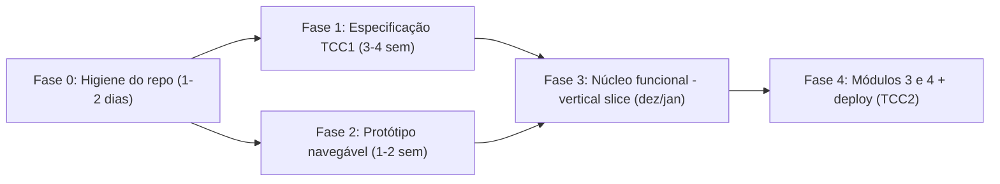

# Estado do TCC e plano do sistema (v0.1, rascunho para refinarmos)

> [!NOTE]
> Data da análise: 19/10/2026. Fontes: repositório `git/documentacaoTCC` (Monografia + `Desenvolvimento/Site`), [tcc-projeto.html](file:///home/georgios/Área%20de%20trabalho/Fatec/TCC/git/documentacaoTCC/Desenvolvimento/Site/tcc-projeto.html), [Cronograma TG1](file:///home/georgios/Área%20de%20trabalho/Fatec/TCC/git/documentacaoTCC/Monografia/00%20-%20Gestão%20&%20Dashboard/Cronograma%20&%20Entregas%20TG1.md) e os papéis do Maestri em `Site/.maestri/roles`.

---

## 1. Onde estamos

### Linha do tempo (segundo a proposta)
| Fase | Período | O que se espera do **sistema** |
|---|---|---|
| **TCC 1** (agora) | set–dez/2026 (**faltam ~7 semanas**) | **Especificação**: requisitos (RF/RNF), modelagem do BD, protótipo navegável, plano de testes, motor de score validado em planilha, questionário de diagnóstico, templates de políticas (PSI, Acesso, Backup) |
| **TCC 2** | fev–jun/2027 | **Implementação** dos 4 módulos, deploy, estudo de caso com a empresa parceira |

### Monografia
- Estrutura do Obsidian pronta, com notas-base (NIST, C2M2, ativos, ameaças, funções GV…RC).
- Cronograma: M4–M10 **pendentes** (fichamentos, Cap. 1 e 2, matriz preliminar, revisão com orientador). O Cap. 4 (Framework) é só um esqueleto de títulos.
- ⚠️ A proposta do Bruno (Módulos 3/4, OED 7–9) está marcada como **"pendente de alinhamento com o grupo e com o orientador"**.

### Sistema (`Desenvolvimento/Site`, Spring Boot 4.1.1 / Java 21)
| Camada | Situação |
|---|---|
| Entidades JPA | ✅ 30 classes em 5 domínios (`core`, `ativo`, `diagnostico`, `governanca`, `compliance`). Compila. |
| Telas (8 templates) | 🟡 Mockups HTML/CSS **estáticos**: landing (`index`), `login`, `dashboard`, `diagnostico`, `acompanhamento`, `governanca`, `compliance`, `configuracoes`. Usam só `th:href`, sem nenhum `${...}` (nenhum dado dinâmico). |
| Controllers / Services / Repositories | ❌ Não existem. Nenhuma rota responde. |
| Config do banco (`application.properties`) | ❌ Só tem o nome da aplicação. Com JPA + MySQL e sem URL, **a aplicação não sobe**. |
| Seed (questionário NIST×MIL, funções, templates) | ❌ Inexistente |
| Motor de score / gaps | ❌ Inexistente |
| Segurança (login, perfis, LGPD) | ❌ Sem Spring Security nem Bean Validation no `pom.xml` |
| Testes | ❌ Só o teste de contexto padrão |

### Problemas de higiene e consistência
1. A pasta `target/` e a `.idea/` estão **versionadas no git** (dá conflito a cada build).
2. Tem um projeto duplicado/legado em `Desenvolvimento/06 - Desenvolvimento/microsec`.
3. A reorganização das pastas para `Monografia/` ainda **não foi commitada** (o git mostra os arquivos antigos como deletados e a pasta nova sem rastreamento).
4. Nome inconsistente: pacote `br.edu.securedesk`, artefato `microsec`, teste `MicrosecApplicationTests`.
5. `TipoAtivo` tem 6 valores (ENDPOINT, SERVIDOR, REDE_PERIMETRO, MOVEL, NUVEM, OUTRO), mas a monografia define **4 categorias**.
6. `Diagnostico.milMedio` (média de 0 a 3) **contradiz o C2M2**. Lá o MIL é **cumulativo**: só se chega ao MIL 2 com todas as práticas de MIL 1 e MIL 2 atendidas. Essa regra precisa ser definida na monografia **antes** de virar código.
7. Não existe vínculo entre questão e categoria de ativo, embora o papel do Team Leader prometa "cruzar ativos com as funções NIST". Também falta a trava de 100 ativos.
8. Papéis do Maestri: o do Team Leader está detalhado, mas Flash 1, Flash 2 e GPT-OSS 120B têm só um prompt genérico ("Faça apenas o pedido…").

> [!IMPORTANT]
> **Conclusão:** o código está **adiantado** em relação ao TCC 1 (entidades e telas), mas os **entregáveis formais de engenharia do TCC 1 ainda não existem**: requisitos, DER, plano de testes, planilha do score e questionário. É isso que a banca do TG1 vai cobrar. Proposta: usar os mockups HTML **no lugar do Figma** como protótipo navegável (precisa do aval do orientador).

---

## 2. Plano faseado



### Fase 0: Higiene do repositório (fazer já)
- [ ] Commitar a reorganização `Monografia/` (adiado a pedido do usuário).
- [x] Criar `.gitignore` para `target/`, `.idea/` e `.vscode/` e tirar essas pastas do índice (`git rm -r --cached`).
- [x] Decidir o que fazer com `06 - Desenvolvimento/microsec` (remover ou arquivar) → **Removido**.
- [x] Padronizar o nome do produto (SecureDesk ou MicroSec) → **Padronizado para SecureDesk (`securedesk`)**.
- [x] Configurar `application.properties` com perfis `dev` (H2 em memória) e `prod` (MySQL/MariaDB). Objetivo: `./mvnw spring-boot:run` subir de primeira.
- [ ] Ideal: separar o código num repositório próprio (ou num submódulo) para não misturar com o Obsidian.

### Fase 1: Especificação do sistema (entregável do TG1)
| # | Artefato | Origem / responsável sugerido |
|---|---|---|
| 1.1 | ✅ **Documento de Requisitos** (`docs/REQUISITOS.md` — RF/RNF, regras de negócio, casos de uso) | Concluído v1 por Argon (Supervisor) + pronto para revisão humana |
| 1.2 | ✅ **DER / modelo relacional** (`docs/DER.md` — Mermaid `erDiagram` + relatório de inconsistências) | Concluído por Flash 1 (ajustes no código aguardam decisões da seção 3) |
| 1.3 | ✅ **Questionário de diagnóstico** (OED 3): `docs/QUESTIONARIO_DIAGNOSTICO.md` (30 questões — 5 por função GV/ID/PR/DE/RS/RC, 4 opções MIL 0..3, mapeadas ao NIST CSF 2.0 + ISO 27002:2022 + metadados de Gap) | Concluído por Flash 1 (pronto para revisão do Grupo e geração de `data.sql`) |
| 1.4 | ✅ **Fórmula do score validada em planilha** (OED 1): `docs/ESPECIFICACAO_SCORE_C2M2.md` (regra cumulativa por função, MIL global, score %, fórmulas de planilha e 8 casos de teste) | Concluído por GPT-OSS 120B + revisado por Argon (pronto para validação com Gabriel) |
| 1.5 | ✅ **Templates de políticas** PSI, Controle de Acesso e Backup (OED 2): `docs/TEMPLATES_POLITICAS.md` (com placeholders padronizados e mapeamento ISO 27001/27002 + LGPD) | Concluído por GPT-OSS 120B (pronto para revisão do Lucas) |
| 1.6 | ✅ **Plano de testes** (`docs/PLANO_TESTES.md` — unitários do motor de score e trava de 100 ativos, integração/segurança e UAT na empresa parceira) | Concluído por Flash 2 |
| 1.7 | ✅ **Mapeamento LGPD** (OEM 6a): `docs/MAPEAMENTO_LGPD.md` (papéis Controlador/Operador, RoPA das 17 tabelas, princípios Art. 6º e fluxo `TermoConsentimentoLgpd`) | Concluído por Argon (Supervisor) + pronto para revisão do Grupo |

### Fase 2: Protótipo navegável (substitui o Figma)
- [x] Criar um `PageController` simples que sirva as 8 telas com dados fictícios via `Model`, para dar para clicar em tudo.
- [x] Revisar a landing (`index.html`), que funciona como **site institucional**, e o fluxo login → onboarding → diagnóstico → radar.
- [x] Extrair os fragmentos Thymeleaf repetidos (sidebar e header aparecem em todas as telas).

### Fase 3: Núcleo Funcional em Clean Architecture (Opção A — Estrita e Manutenível)

A implementação segue estritamente a **Clean Architecture (Robert C. Martin / Baeldung)**, garantindo independência total de frameworks no núcleo de negócio, testabilidade pura e alta manutenibilidade.

#### 3.0 Ajuste de Dependências (`pom.xml`)
- [ ] Adicionar `spring-boot-starter-validation`: suporte a Bean Validation (`@Valid`, `@NotBlank`, `@Size`, `@Min`, `@Max`).
- [ ] Adicionar `spring-boot-starter-security`: autenticação real, proteção CSRF em formulários web, hash adaptativo **BCrypt** de senhas e autorização baseada em papéis (`ADMINISTRADOR`, `EDITOR`, `VISUALIZADOR`).

#### 3.1 Estrutura em Camadas da Clean Architecture (Opção A)
Para manter um sistema grande legível e simples de manter, o código é estruturado em **fatias verticais por domínio** (`core`, `ativo`, `diagnostico`, `governanca`, `compliance`), com responsabilidades estritas:

```mermaid
flowchart TD
    subgraph UI_DB["Frameworks & Drivers (Infraestrutura)"]
        WebMvc["Spring MVC / Thymeleaf / Security"]
        H2_MySQL["Spring Data JPA / Hibernate / H2 / MariaDB"]
    end

    subgraph Adapters["Interface Adapters"]
        Controllers["Controllers Especializados (HTTP)"]
        Presenters["Presenters / ViewModels"]
        GatewaysImpl["Gateways de Persistência (Implementações)"]
        DataMappers["JPA Data Mappers (@Entity isolado)"]
    end

    subgraph UseCases["Use Cases (Regras de Aplicação)"]
        InputBound["Input Boundary (Interfaces)"]
        Interactors["Use Case Interactors"]
        OutputBound["Output Gateways (Interfaces)"]
        Models["Request & Response Models (Records)"]
    end

    subgraph Domain["Domain (Regras de Negócio Puras)"]
        Entities["Entidades de Domínio & Invariantes (POJOs puros)"]
    end

    WebMvc --> Controllers
    Controllers --> InputBound
    Interactors ..|> InputBound
    Interactors --> Entities
    Interactors --> OutputBound
    GatewaysImpl ..|> OutputBound
    GatewaysImpl --> H2_MySQL
    GatewaysImpl --> DataMappers
    DataMappers --> H2_MySQL
```

- **`domain` (Núcleo Puro):** POJOs e Records sem nenhuma anotação de framework (`@Entity`, `@Table`, etc.). Contém invariantes e validações intrínsecas (ex: regras de ativo, transição de estados de tarefa, cumulatividade do MIL).
- **`usecase` (Casos de Uso):**
  - `boundary.input`: Interfaces que expõem as operações para os controllers.
  - `boundary.output`: Interfaces que declaram os contratos de persistência (Gateways) e apresentação (Presenters).
  - `interactor`: Implementações da lógica da aplicação e orquestração das entidades.
  - `model`: DTOs simples (Java 21 Records) para entrada (`RequestModel`) e saída (`ResponseModel`).
- **`adapter.controller`:** Controllers HTTP desacoplados, com injeção apenas de `InputBoundary`.
- **`adapter.gateway`:** Adaptadores de persistência que convertem entre entidades de domínio puras e `DataMappers`.
- **`infrastructure.persistence`:** Classes `@Entity` do JPA (DataMappers) e interfaces `JpaRepository` isoladas da regra de negócio.

##### Estrutura de Pacotes Adotada (`Package by Feature / Module`):
```text
br.edu.securedesk/
├── core/                           # Empresa, Usuário, Autenticação e LGPD
│   ├── domain/                     # Usuario, Empresa, TermoConsentimento (POJOs puros)
│   ├── usecase/                    # Interactors, Boundaries, Records de Request/Response
│   ├── adapter/                    # AuthController, UsuarioController, EmpresaConfigController, GatewaysImpl
│   └── infrastructure/             # UsuarioDataMapper, EmpresaDataMapper, Repositories JPA
├── ativo/                          # Inventário de Ativos (Pequeno Parque <= 100)
│   ├── domain/                     # Ativo, TipoAtivo, RegraTrava100Ativos
│   ├── usecase/                    # CadastrarAtivoInteractor, AtivoInputBoundary, AtivoGateway
│   ├── adapter/                    # AtivoController, AtivoGatewayImpl
│   └── infrastructure/             # AtivoDataMapper, JpaAtivoRepository
├── diagnostico/                    # Assessment NIST CSF 2.0 x C2M2
│   ├── domain/                     # Diagnostico, FuncaoNist, NivelMil, ScoreFuncao
│   ├── usecase/                    # CalcularScoreInteractor (regra cumulativa), DiagnosticoGateway
│   ├── adapter/                    # DiagnosticoController, AcompanhamentoController (Radar)
│   └── infrastructure/             # DiagnosticoDataMapper, RespostaDataMapper, Repositories JPA
├── governanca/                     # Governança Operacional (Kanban e Evidências)
│   ├── domain/                     # TarefaRemediacao, Gap, Evidencia
│   ├── usecase/                    # GerenciarTarefaInteractor, TarefaGateway
│   ├── adapter/                    # GovernancaController, TarefaGatewayImpl
│   └── infrastructure/             # TarefaDataMapper, EvidenciaDataMapper, Repositories JPA
└── compliance/                     # Compliance e Políticas
    ├── domain/                     # PoliticaEmpresa, TemplatePolitica, HistoricoRevisao
    ├── usecase/                    # AdotarPoliticaInteractor, PoliticaGateway
    ├── adapter/                    # ComplianceController, PoliticaGatewayImpl
    └── infrastructure/             # PoliticaDataMapper, TemplateDataMapper, Repositories JPA
```

#### 3.2 Implementação dos 4 CRUDs Funcionais Completos + Motor de Diagnóstico
Ordem de implementação ponta a ponta (Domain $\rightarrow$ UseCase $\rightarrow$ Gateway $\rightarrow$ Controller $\rightarrow$ Thymeleaf Binding $\rightarrow$ Testes):

1. **CRUD 1 — Gestão do Inventário de Ativos de TI (`AtivoTI`) [Prioridade Inicial]**
   - **Regra Central (`RN01`):** Trava estrita de **no máximo 100 ativos gerenciados** ($\sum \text{quantidade} \le 100$). Qualquer inclusão ou alteração que exceda 100 unidades é rejeitada no caso de uso.
   - **Operações:** Cadastrar ativo, Listar/Filtrar por categoria (`ENDPOINTS`, `SERVIDORES`, `REDE`, `NUVEM_MOVEL`), Atualizar dados/quantidade com revalidação da trava, Excluir/Inativar liberando cota.
   - **Entregáveis:** `Ativo`, `CadastrarAtivoInputBoundary`, `AtivoGateway`, `AtivoController`, binding em `ativos.html`, testes unitários de trava.

2. **CRUD 2 — Gestão de Usuários da PME (`Usuario`)**
   - **Regras Centrais (`RN04`, `RN05`, `RNF01`):** Isolamento multi-tenant por empresa, criptografia de senhas com BCrypt, perfis de acesso (`ADMINISTRADOR`, `EDITOR`, `VISUALIZADOR`) e rastreabilidade de consentimento LGPD.
   - **Operações:** Cadastrar usuário vinculado à empresa, Listar colaboradores, Atualizar perfil/dados, Desativar/Ativar conta.
   - **Entregáveis:** `Usuario`, `UsuarioGateway`, `UsuarioController`, telas de gestão de usuários em `configuracoes.html`.

3. **CRUD 3 — Governança Operacional: Tarefas de Remediação & Evidências (`TarefaRemediacao`)**
   - **Regras Centrais:** Vínculo a `Gap` e às funções NIST, ciclo de transição de status no Kanban (`BACKLOG` $\rightarrow$ `EM_ANDAMENTO` $\rightarrow$ `CONCLUIDO`).
   - **Operações:** Criar tarefa (manual ou originada de gap), Listar colunas do Kanban, Atualizar status/responsável/prazo, Concluir/Cancelar, Anexar registro de evidência comprobatória (`Evidencia`).
   - **Entregáveis:** `TarefaRemediacao`, `TarefaGateway`, `GovernancaController`, binding real no `governanca.html`.

4. **CRUD 4 — Compliance: Gestão e Customização de Políticas (`PoliticaEmpresa`)**
   - **Regras Centrais:** Formalização documental para atingir o nível **MIL 2** do C2M2; adoção a partir de templates oficiais (PSI, Controle de Acesso, Backup 3-2-1); controle de ciclo de vida (`EM_ELABORACAO`, `PENDENTE_REVISAO`, `EM_DIA`, `VENCIDA`) e alerta de revisão periódica.
   - **Operações:** Adotar template, Listar políticas da empresa com status, Editar conteúdo customizado, Registrar histórico de versões (`HistoricoRevisaoPolitica`), Revogar/Excluir.
   - **Entregáveis:** `PoliticaEmpresa`, `PoliticaGateway`, `ComplianceController`, binding real no `compliance.html`.

5. **Motor Central — Diagnóstico de Maturidade (Assessment NIST CSF 2.0 × C2M2)**
   - **Regras Centrais (`RN02`, `RN03`):** Algoritmo de score cumulativo do C2M2 (degraus MIL 0 a MIL 3 por função), percentual de progresso contínuo, geração automática de `Gap` para respostas abaixo de MIL 2 e matriz de priorização (Impacto × Custo / Quick Wins).
   - **Operações:** Abertura de sessão de diagnóstico, salvamento de respostas parciais por função, finalização com cálculo do motor de score e geração de gaps.
   - **Entregáveis:** `CalcularScoreInteractor`, `DiagnosticoController`, Radar Chart.js no `acompanhamento.html`.

#### 3.3 Decomposição dos Controllers Especializados
Substituição progressiva do `PageController` monolítico por controllers coesos e bem definidos:
- `HomeController`: Landing institucional pública e apresentação da plataforma (`GET /`).
- `AuthController`: Login, logout, controle de sessão Spring Security e aceite do termo LGPD (`/login`, `/logout`, `/consentimento-lgpd`).
- `DashboardController`: Painel executivo consolidado, KPIs da PME e atalhos rápidos (`GET /dashboard`).
- `AtivoController`: Rotas do CRUD de ativos (`/ativos`, `/ativos/novo`, `/ativos/{id}/editar`, etc.).
- `UsuarioController`: Rotas de gestão de usuários da empresa (`/configuracoes/usuarios/*`).
- `DiagnosticoController`: Ciclo do assessment, submissão de respostas e exibição do Radar (`/diagnostico/*`, `/acompanhamento`).
- `GovernancaController`: Quadro Kanban e gestão de evidências (`/governanca/*`).
- `ComplianceController`: Catálogo de templates e gestão de políticas (`/compliance/*`).
- `EmpresaConfigController`: Atualização de dados cadastrais da PME (`/configuracoes/empresa`).

#### 3.4 Binding Real nos Templates Thymeleaf
- Transformação dos formulários estáticos atuais em formulários dinâmicos com bindings oficiais do Spring MVC:
  - Uso de `th:object="${formDto}"`, `th:field="*{campo}"`, `th:action="@{/rota}"`.
  - Exibição de alertas de validação por campo com `th:if="${#fields.hasErrors('campo')}"` e `th:errors="*{campo}"`.
  - Feedback visual de operações (criação, edição, exclusão) via mensagens de alerta alimentadas por Flash Attributes (`redirectAttributes.addFlashAttribute("sucesso", ...)`).

#### 3.5 Testes Unitários Puros de Caso de Uso
- Testes automatizados com JUnit 5 cobrindo 100% das regras de negócio dos Interactors **sem carregar o contexto Spring Boot nem banco de dados** (execução em milissegundos):
  - Trava estrita de 100 ativos (`RN01`): cenários de inclusão dentro do limite, na borda (100) e tentativa de estouro (101).
  - Algoritmo cumulativo C2M2 (`RN02`): os 8 casos de teste matemáticos especificados em `docs/ESPECIFICACAO_SCORE_C2M2.md`.
  - Regras de transição de status no Kanban e no ciclo de vida de políticas.

#### 3.6 Viabilidade e Estratégia: Construção do Sistema Primeiro e Documentação/Carga Posteriormente
- **Pergunta Central:** *É possível construir todo o sistema primeiro e deixar a elaboração/carga dos documentos para depois?*
- **Resposta e Diretriz Oficial:** **SIM, com certeza!** Essa estratégia não apenas é 100% viável, como é a **melhor prática de engenharia**:
  1. **Independência dos CRUDs e Casos de Uso:** Nenhum dos 4 CRUDs (Ativos, Usuários, Tarefas, Políticas) nem a arquitetura limpa dependem dos textos finais das 30 questões do NIST ou do conteúdo completo das minutas de políticas para serem construídos, testados e homologados.
  2. **Uso de Fixtures e Mocks nos Testes:** O motor de score (`ScoreService`/`CalcularScoreInteractor`) e os testes unitários (`UT-SCORE-01..08`) utilizam massas de dados de teste (fixtures sintéticas), permitindo validar a matemática cumulativa do C2M2 e a trava de 100 ativos com precisão cirúrgica sem depender de banco povoado.
  3. **Zero Retrabalho na Documentação e Monografia:** Ao ter o sistema rodando com controllers reais, validações e telas dinâmicas, a confecção manual dos documentos finais (redação dos capítulos do TG1, inserção das 30 questões do questionário e publicação dos 3 templates de políticas) torna-se muito mais rápida, consistente e precisa, pois reflete um software que já funciona e já foi testado na prática.
  4. **Fluxo de Execução:**
     - **Etapa Atual (Foco dos Agentes):** Dependências $\rightarrow$ Clean Architecture (`Package by Feature`) $\rightarrow$ Casos de Uso $\rightarrow$ Controllers Especializados $\rightarrow$ Bindings Thymeleaf $\rightarrow$ Testes Unitários/Integração.
     - **Etapa Posterior (Homologação Manual):** Carga dos scripts definitivos de questionário/templates no banco de dados e refinamento textual dos relatórios/monografia do TCC.

---

## 3. Decisões Arquiteturais e Alinhamentos Consolidados

1. **Estilo Arquitetural (Opção A — Clean Architecture Estrita):**
   - Decidido: Adotar o modelo clássico do Uncle Bob / Baeldung com separação explícita entre entidades de domínio puras (`domain`) e entidades de persistência (`infrastructure.persistence` com `DataMapper`s).
   - *Como manter simples e de fácil leitura:*
     - Agrupamento vertical por módulo (`core`, `ativo`, `diagnostico`, `governanca`, `compliance`).
     - Uso de Java 21 Records para Request/Response Models.
     - Métodos de conversão estáticos e diretos entre Entity e DataMapper, sem bibliotecas mágicas complexas.
2. **Escopo dos CRUDs:**
   - Confirmados os 4 CRUDs completos: Ativos de TI (com trava de 100), Usuários da PME, Tarefas de Remediação (Kanban) e Políticas de Segurança.
3. **Especialização dos Controllers:**
   - Confirmada a substituição do `PageController` provisório por 9 controllers focados.
4. **Dependências:**
   - Inclusão mandatória de `spring-boot-starter-validation` e `spring-boot-starter-security` no `pom.xml`.
5. **Carga de Dados:**
   - Desacoplada da construção da arquitetura; realizada manualmente como etapa de homologação posterior.

---

## 4. Organização do Time no Maestri (Clean Architecture)

| Agente | Foco Arquitetural na Clean Architecture | Atribuições Principais |
|---|---|---|
| **Team Leader (Argon)** | Tech Lead & Contratos | Define as interfaces de fronteira (`InputBoundary`, `OutputBoundary`), orquestra a integração entre camadas e revisa Pull Requests. |
| **GPT-OSS 120B** | Domínio e Casos de Uso (`domain` + `usecase`) | Modela as entidades puras, implementa os Interactors de regras de negócio (`RN01` a `RN06`, Score C2M2) e cria os testes unitários puros (sem framework). |
| **Flash 1** | Infraestrutura e Persistência (`infrastructure.persistence` + `adapter.gateway`) | Modela os DataMappers JPA, interfaces `JpaRepository`, implementa os gateways de persistência e mantém os schemas/scripts SQL. |
| **Flash 2** | Adaptadores Web e Interface (`adapter.controller` + Thymeleaf + QA) | Constrói os controllers especializados, realiza o binding dinâmico dos formulários Thymeleaf (`th:object`/`th:field`), estilização e testes de integração WebMvc. |

---

## 5. Registro de progresso

| Data | Item | Responsável | Resultado |
|---|---|---|---|
| 19/10/2026 | Fase 0 — `.gitignore` criado em `Desenvolvimento/Site/.gitignore` + `git rm -r --cached target/ .idea/ .vscode/` | Argon (Supervisor) | Concluído; pastas removidas do índice git |
| 19/10/2026 | Fase 0 — Perfis `dev` (H2 em memória) e `prod` (MySQL/MariaDB) em `application.properties` + dependência H2 no `pom.xml` | Argon (Supervisor) | Concluído e validado com `./mvnw -q test` (exit 0, 17 tabelas criadas no H2) |
| 19/10/2026 | Fase 0 — Remoção de `Desenvolvimento/06 - Desenvolvimento/microsec` e padronização de nome para `securedesk` (`pom.xml` e `SecureDeskApplicationTests`) | Argon (Supervisor) | Concluído |
| 19/10/2026 | Seção 4 — Definição dos prompts de papel (roles) de `Flash 1`, `Flash 2` e `GPT-OSS 120B` via `maestri role write` | Argon (Supervisor) | Concluído |
| 19/10/2026 | Fase 1 (Item 1.1) — Rascunho completo do Documento de Requisitos (`docs/REQUISITOS.md`) com RF01–RF19, RN01–RN06, RNF01–RNF06, Casos de Uso e Matriz OEM/OED | Argon (Supervisor) | Concluído |
| 19/10/2026 | Fase 1 (Item 1.2) — Geração do DER em Mermaid (`docs/DER.md`) cobrindo as 17 tabelas + Dicionário de Dados + 8 Inconsistências Código × Monografia | Flash 1 | Concluído |
| 19/10/2026 | Fase 1 (Item 1.4) — Especificação do Algoritmo de Score Cumulativo C2M2 × NIST CSF 2.0 (`docs/ESPECIFICACAO_SCORE_C2M2.md`) + Fórmulas de Planilha OED 1 + 8 Casos de Teste | GPT-OSS 120B + Argon | Concluído |
| 19/10/2026 | Fase 2 — Protótipo Navegável completo: `PageController` (8 rotas GET + POST `/login`), fragmentos Thymeleaf (`fragments/layout.html`), dados dinâmicos no `Model` e `PageControllerTest` | Flash 2 | Concluído e validado com `./mvnw -q test` (10/10 testes passando) |
| 20/10/2026 | Fase 1 (Item 1.7 / OEM 6a) — Mapeamento de Conformidade LGPD (`docs/MAPEAMENTO_LGPD.md`) com RoPA das 17 tabelas, princípios Art. 6º e fluxo de consentimento/anonimização | Argon (Supervisor) | Concluído |
| 20/10/2026 | Fase 1 (Item 1.5 / OED 2) — Templates Base Editáveis de Políticas: PSI, Controle de Acesso e Backup 3-2-1 (`docs/TEMPLATES_POLITICAS.md`) | GPT-OSS 120B | Concluído |
| 20/10/2026 | Fase 1 (Item 1.6 / OEM 7a) — Plano de Testes de Software (`docs/PLANO_TESTES.md` — Unitários, Integração/Segurança e UAT com métricas SUS) | Flash 2 | Concluído |
| 20/10/2026 | Fase 1 (Item 1.3 / OED 3) — Instrumento Completo de Diagnóstico (`docs/QUESTIONARIO_DIAGNOSTICO.md` — 30 questões, 120 opções MIL 0..3, mapeamento NIST CSF 2.0 + ISO 27002:2022 + metadados de Gap) | Flash 1 | Concluído |
| 21/10/2026 | Fase 3 — Especificação da Clean Architecture Estrita (Opção A), definição detalhada dos 4 CRUDs, 9 Controllers especializados, estratégia de dependências e seed manual posterior | Alinhamento Geral | Concluído e documentado em `docs/PLANO_DESENVOLVIMENTO.md` |


