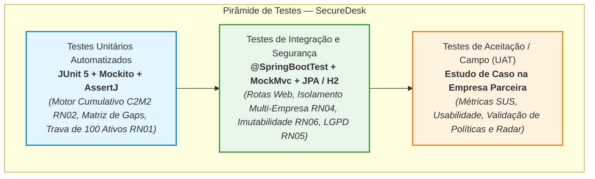
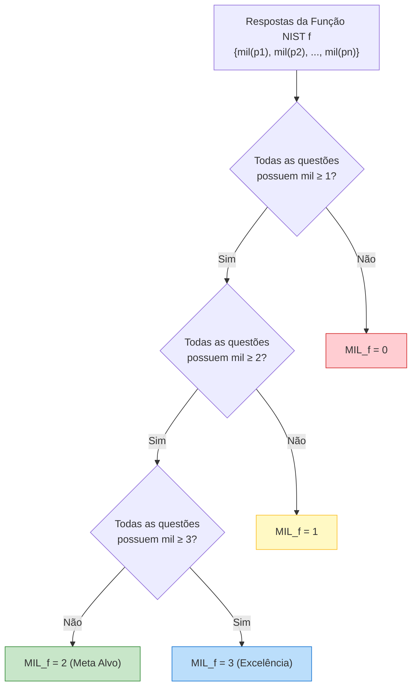
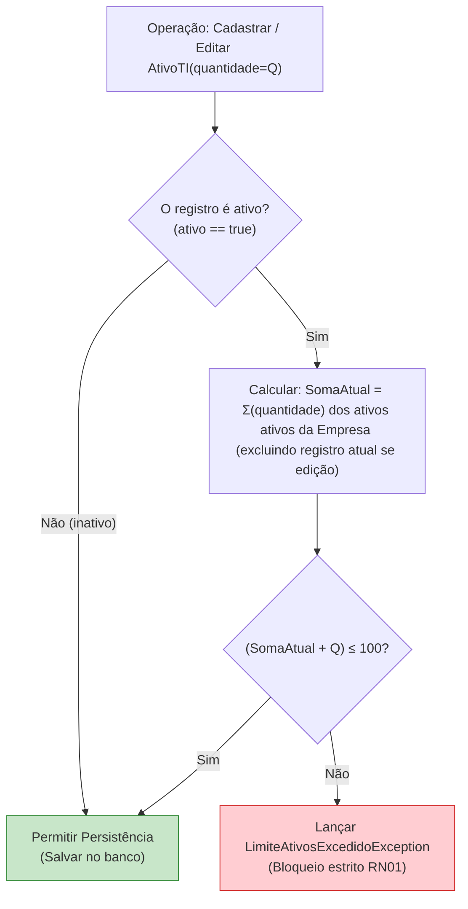
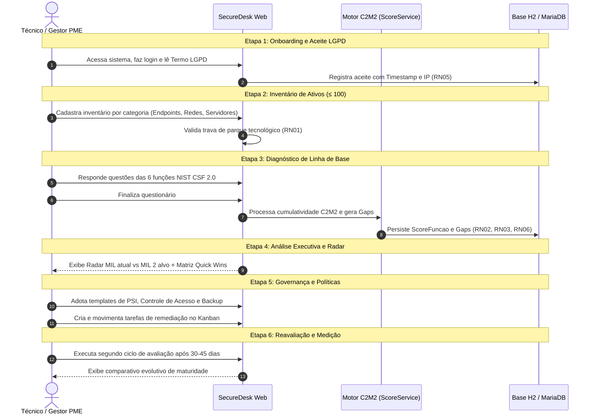
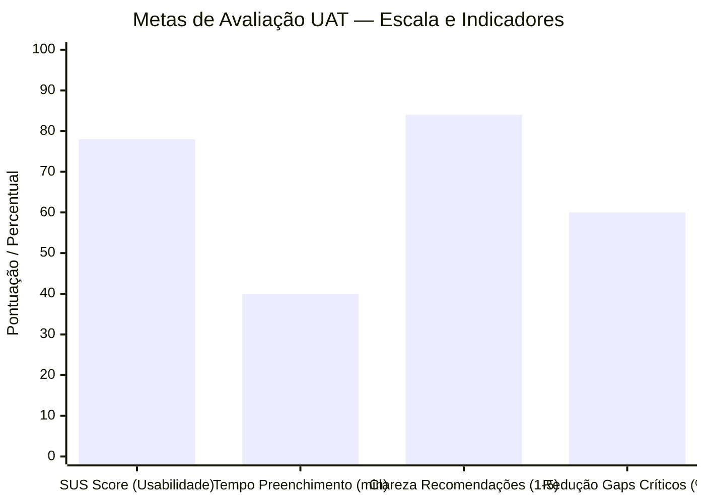

# Plano de Testes de Software — SecureDesk

> [!NOTE]
> **Projeto:** SecureDesk — Plataforma de Diagnóstico e Governança Progressiva de Cibersegurança para Pequenos Parques Tecnológicos (NIST CSF 2.0 × C2M2)  
> **Curso:** Tecnologia em Análise e Desenvolvimento de Sistemas — FATEC Zona Leste (2026–2027)  
> **Autores:** Bruno Cavalcante, Gabriel Andrew, Lucas Oliveira, Rafael Melo  
> **Artefato TG1:** OEM 7a / Item 1.6 do `PLANO_DESENVOLVIMENTO.md`  
> **Versão:** 1.0 — Outubro/2026  

---

## 1. Estratégia e Níveis de Teste

O plano de testes do **SecureDesk** adota os princípios clássicos da Pirâmide de Testes de Engenharia de Software, priorizando uma base sólida de testes automatizados unitários determinísticos, complementada por testes de integração de componentes Spring Boot/JPA e culminando em um protocolo formal de Teste de Aceitação do Usuário (UAT) conduzido no ambiente real da empresa parceira (estudo de caso PME).



### 1.1 Divisão dos Níveis de Teste

| Nível | Tecnologias / Frameworks | Foco de Avaliação | Execução / Frequência |
|---|---|---|---|
| **Testes Unitários (Unit Testing)** | JUnit 5 (`org.junit.jupiter`), Mockito, AssertJ | Algoritmo matemático cumulativo C2M2 (`ScoreService`), regras de priorização de Gaps (Quick Wins), validação de domínio e trava estrita de 100 ativos (`RN01`). | Automatizada a cada build via `./mvnw test` (< 5 segundos). |
| **Testes de Integração (Integration Testing)** | Spring Boot Test (`@SpringBootTest`, `@AutoConfigureMockMvc`), Spring Data JPA, H2 Database em memória (`application-test.properties`) | Ciclo de vida HTTP dos Controllers, renderização de templates Thymeleaf, persistência transacional com constraints de unicidade, isolamento multi-empresa (`RN04`), imutabilidade de diagnósticos concluídos (`RN06`) e fluxo de aceite LGPD (`RN05`). | Automatizada a cada push / validação de PR (< 30 segundos). |
| **Testes de Aceitação do Usuário (UAT)** | Protocolo de Estudo de Caso, Questionário SUS (*System Usability Scale*), Observação Assistida | Validação em ambiente operacional com gestor e analista de TI da PME parceira (até 100 dispositivos gerenciados), cobrindo Onboarding, Inventário, Diagnóstico, Radar e Plano de Ação. | Conduzido no encerramento da implementação (TCC 2 / OEM 8). |

### 1.2 Ambiente e Ferramental de Testes

- **Linguagem & Plataforma:** Java 21 (LTS) sobre Spring Boot 4.1.x / Spring 7.
- **Mecanismo de Execução:** Apache Maven Wrapper (`./mvnw clean test`).
- **Base de Dados de Teste:** H2 Database em memória (`jdbc:h2:mem:securedesk_test;DB_CLOSE_DELAY=-1;MODE=MySQL`), garantindo portabilidade, isolamento de estado entre testes (`@Transactional` / rollback) e independência de bancos externos.
- **Critérios de Cobertura e Gates de Qualidade:**
  - **100% de cobertura** nas regras determinísticas de cálculo cumulativo C2M2 e geração de Gaps em `ScoreService`.
  - **100% de cobertura** na regra de validação de limite de ativos (RN01) em `AtivoService`.
  - **100% de aprovação** (0 falhas e 0 erros) no pipeline de testes automatizados antes de qualquer entrega ou release.

---

## 2. Especificação de Testes Unitários (Domínio e Motor de Score)

### 2.1 Cenários Determinísticos do Motor C2M2 × NIST CSF 2.0 (`UT-SCORE-01` a `UT-SCORE-08`)

Estes testes espelham rigorosamente os cenários matemáticos definidos em `docs/ESPECIFICACAO_SCORE_C2M2.md`, assegurando a fidelidade à regra cumulativa estrita do C2M2:
$$\text{MIL}_f = \max \left\{ l \in \{0,1,2,3\} \;\middle|\; \forall p \in \bigcup_{k=0}^{l} P_{f,k} : \text{mil}(p) \ge l \right\}$$



#### Especificação Detalhada dos Casos de Teste de Score:

| Identificador | Título do Cenário | Vetor de Entrada (MIL das Questões) | Saída Esperada: `MIL_f` e Progresso % | Comportamento de Gaps e Prioridades | Justificativa Teórico-Prática |
|---|---|---|---|---|---|
| **`UT-SCORE-01`** | Empresa Iniciada (Linha de Base Zero) | Todas as questões de todas as 6 funções respondidas com `MIL_0`. | - `MIL_f = 0` para GV, ID, PR, DE, RS, RC.<br>- `scorePercentual_f = 0.0%`.<br>- `milGlobal = 0.00`.<br>- `scoreGlobal = 0.0%`. | 100% das questões geram `Gap` com `milAtual = 0`, `milAlvo = 2`, `resolvido = false`. | Valida o estado inicial de uma PME sem controles de segurança formalizados. |
| **`UT-SCORE-02`** | Degrau MIL 1 Plenamente Concluído | Todas as questões da função respondidas com `MIL_1`. | - `MIL_f = 1` para todas as funções.<br>- `scorePercentual_f = 33.33%`.<br>- `milGlobal = 1.00`.<br>- `scoreGlobal = 33.33%`. | Todas as questões geram `Gap` (`milAtual = 1`, `milAlvo = 2`). | Confirma fechamento do nível inicial de práticas informais executadas. |
| **`UT-SCORE-03`** | Buraco Cumulativo C2M2 (Trava Estrita) | Função `PR` com 5 questões: 4 em `MIL_3` e 1 em `MIL_0` (`[3, 3, 3, 3, 0]`). | - `MIL_PR = 0` (trava estrita!).<br>- `scorePercentual_PR = 80.0%` (12/15). | 1 `Gap` gerado para a questão em `MIL_0` com distância = 2. | **Caso crítico da banca acadêmica:** a média aritmética ingênua resultaria em `2.4` (MIL 2 fictício), mas a cumulatividade do C2M2 retém a função em `MIL 0` até que a prática básica seja sanada. O percentual de 80% exibe o progresso no dashboard sem mascarar o risco. |
| **`UT-SCORE-04`** | Bloqueio no Degrau MIL 2 | Função `ID` com 5 questões: 4 em `MIL_2` e 1 em `MIL_1` (`[2, 2, 2, 2, 1]`). | - `MIL_ID = 1`.<br>- `scorePercentual_ID = 60.0%` (9/15). | 1 `Gap` gerado para a questão em `MIL_1` com distância = 1. | Todas as questões atendem a `≥ MIL 1` (degrau 1 consolidado), mas a pendência de 1 prática impede atingir formalmente o nível 2. |
| **`UT-SCORE-05`** | Patamar Recomendado Alvo Atingido (MIL 2) | Todas as questões de todas as funções respondidas com `MIL_2`. | - `MIL_f = 2` em todas as funções.<br>- `scorePercentual_f = 66.67%`.<br>- `milGlobal = 2.00`.<br>- `scoreGlobal = 66.67%`. | **Zero Gaps gerados** (todas atingiram ou superaram o patamar recomendado). | Ponto ideal de maturidade exigido para conformidade essencial (ISO 27001/27002 adaptada a PMEs). |
| **`UT-SCORE-06`** | Excelência Operacional Máxima (MIL 3) | Todas as questões de todas as funções respondidas com `MIL_3`. | - `MIL_f = 3` para todas as funções.<br>- `scorePercentual_f = 100.0%`.<br>- `milGlobal = 3.00`.<br>- `scoreGlobal = 100.0%`. | Zero Gaps gerados. | Teto superior da escala de maturidade contínua e institucionalizada. |
| **`UT-SCORE-07`** | Perfil Realista Desbalanceado de PME | Vetor de funções: `GV=1`, `ID=2`, `PR=1`, `DE=0`, `RS=0`, `RC=1`. | - `milGlobal = 0.83` (média simples dos MILs).<br>- Scores percentuais heterogêneos por função. | Gaps gerados nas funções com questões `< MIL 2`. | Simula o cenário comum de PME onde Identificação e Proteção existem timidamente, mas Detecção e Resposta a Incidentes são inexistentes. |
| **`UT-SCORE-08`** | Priorização de Gaps (Quick Wins vs Longo Prazo) | Questão A: `MIL_0`, Impacto `ALTO`, Custo `BAIXO`.<br>Questão B: `MIL_1`, Impacto `BAIXO`, Custo `ALTO`. | Ambas geram entidade `Gap`. | - Questão A $\rightarrow$ `Prioridade.CRITICA` (Quick Win prioritário).<br>- Questão B $\rightarrow$ `Prioridade.BAIXA` (Ação postergável). | Valida a Matriz de Priorização `Impacto × Custo`, permitindo à PME direcionar investimentos escassos para ações de retorno imediato. |

### 2.2 Testes da Trava de Pequeno Parque Tecnológico (`UT-ATIVO-01` a `UT-ATIVO-04`)

A regra de negócio **RN01** restringe o escopo metodológico do sistema a empresas com **até 100 dispositivos gerenciados**. O cálculo do parque considera exclusivamente ativos com `ativo = true`:
$$\sum_{\text{ativoTI} \in \text{ativos da empresa, ativo=true}} \text{ativoTI.quantidade} \le 100$$



#### Especificação dos Casos de Teste de Ativos:

| Identificador | Título do Cenário | Estado Atual do Parque da PME | Operação Solicitada | Resultado Esperado | Validação Técnica / Exceção |
|---|---|---|---|---|---|
| **`UT-ATIVO-01`** | Adição no Limite Máximo Permitido | 99 ativos ativos cadastrados (ex: 70 endpoints, 10 servidores, 19 switches). | Cadastro de 1 novo ativo com `quantidade = 1` e `ativo = true`. | Sucesso (Soma = 100). Registro persistido. | Operação concluída sem erros; método de persistência invocado com sucesso. |
| **`UT-ATIVO-02`** | Bloqueio de Extrapolação do Parque | 100 ativos ativos cadastrados na empresa. | Tentativa de cadastro de 1 novo ativo (`quantidade = 1`, `ativo = true`). | **Rejeição Obrigatória.** | Lançamento de `LimiteAtivosExcedidoException` com mensagem contextualizando o limite do framework de 100 dispositivos. O repositório não persiste o registro. |
| **`UT-ATIVO-03`** | Atualização de Lote que Excede Limite | Total da empresa = 98 ativos. Lote existente de 10 estações de trabalho. | Edição desse lote alterando a `quantidade` de 10 para 15 (novo total seria 103). | **Rejeição Obrigatória.** | Lançamento de `LimiteAtivosExcedidoException`. A transação sofre rollback e a quantidade original (10) é preservada. |
| **`UT-ATIVO-04`** | Desconsideração de Ativos Inativos/Descartados | Empresa com 95 ativos ativos e 50 ativos inativos (`ativo = false`, máquinas aposentadas/descartadas). | Cadastro de 5 novos ativos ativos (`quantidade = 5`, `ativo = true`). | Sucesso (Soma dos ativos ativos = 100). | A consulta de soma ignora registros onde `ativo = false`, permitindo o aproveitamento do histórico sem bloquear a quota operacional. |

---

## 3. Especificação de Testes de Integração e Segurança (Web, JPA e LGPD)

### 3.1 Rotas Web e Renderização de Templates (`IT-WEB-01` a `IT-WEB-09`)

Os testes de integração web utilizam `@SpringBootTest` com `@AutoConfigureMockMvc` para validar o pipeline HTTP, os mapeamentos do `PageController`, os contratos de modelo Thymeleaf e os redirecionamentos.

| Identificador | Rota / Método HTTP | Perfil / Autenticação | Status Esperado | Validações do Teste |
|---|---|---|---|---|
| **`IT-WEB-01`** | `GET /` | Público (Anônimo) | `200 OK` | Renderiza landing page institucional (`core/index.html`), verifica elementos de apresentação da proposta de valor NIST/C2M2. |
| **`IT-WEB-02`** | `GET /login` | Público (Anônimo) | `200 OK` | Renderiza formulário de login (`core/login.html`), contendo inputs de e-mail e senha. |
| **`IT-WEB-03`** | `POST /login` | Credenciais Válidas | `302 Found` | Redireciona para `/dashboard`, inicializando a sessão de navegação autenticada. |
| **`IT-WEB-04`** | `GET /dashboard` | Autenticado | `200 OK` | Renderiza `core/dashboard.html` usando fragmentos `layout.html`, verifica atributos no `Model` (`totalAtivos = 42`, `limiteAtivos = 100`, scores das funções). |
| **`IT-WEB-05`** | `GET /diagnostico` | Autenticado | `200 OK` | Renderiza `diagnostico/diagnostico.html` com as 6 abas das funções NIST e catálogo de questões estruturadas. |
| **`IT-WEB-06`** | `GET /acompanhamento`| Autenticado | `200 OK` | Renderiza `diagnostico/acompanhamento.html` com dados para o gráfico Radar e Matriz de Gaps. |
| **`IT-WEB-07`** | `GET /governanca` | Autenticado | `200 OK` | Renderiza `governanca/governanca.html` com o quadro Kanban de remediação e colunas de status. |
| **`IT-WEB-08`** | `GET /compliance` | Autenticado | `200 OK` | Renderiza `compliance/compliance.html` listando os templates de políticas (PSI, Acesso, Backup). |
| **`IT-WEB-09`** | `GET /configuracoes`| Autenticado | `200 OK` | Renderiza `core/configuracoes.html` com dados da PME e gestão de usuários. |

### 3.2 Isolamento Multi-Empresa / Tenant Isolation (`RN04`)

| Identificador | Título do Cenário | Configuração do Teste | Ação Executada | Resultado Esperado |
|---|---|---|---|---|
| **`IT-SEC-01`** | Tentativa de Acesso a Ativo de Outro Tenant (IDOR) | Usuário autenticado da **Empresa A** (`empresaId = 1`). Ativo ID 99 pertencente à **Empresa B** (`empresaId = 2`). | `GET /api/ativos/99` ou `POST /api/ativos/99/remover` pelo usuário da Empresa A. | **`403 Forbidden` ou `404 Not Found`.** O registro do outro tenant jamais é retornado ou modificado. |
| **`IT-SEC-02`** | Consulta de Diagnósticos Filtrada por Tenant | Empresa A possui 2 diagnósticos; Empresa B possui 5 diagnósticos cadastrados no banco. | Usuário da Empresa A solicita listagem de diagnósticos. | A consulta retorna estritamente os 2 diagnósticos da Empresa A. Zero vazamento de dados de outros clientes. |
| **`IT-SEC-03`** | Tentativa de Vinculação Cruzada no Cadastro | Usuário da Empresa A tenta cadastrar um novo ativo enviando `empresaId = 2` no payload da requisição. | `POST /ativos` com payload adulterado. | O sistema sobrepõe o `empresaId` com a identidade autenticada da sessão (`Empresa A`), prevenindo injeção de tenant. |

### 3.3 Imutabilidade de Diagnósticos Concluídos (`RN06`) e Integridade Relacional

| Identificador | Título do Cenário | Condição Prévia | Ação Executada | Resultado Esperado |
|---|---|---|---|---|
| **`IT-DIAG-01`** | Bloqueio de Edição em Diagnóstico Concluído | Diagnóstico com `status = CONCLUIDO`. | Requisição `PUT /diagnosticos/{id}/respostas` tentando alterar a opção de uma questão. | **Rejeição com erro de negócio (`DiagnosticoConcluidoException`) e status HTTP 400 ou 409.** Nenhuma linha em `tb_resposta_diagnostico` é alterada. |
| **`IT-DIAG-02`** | Unicidade de Resposta por Questão no Mesmo Ciclo | Diagnóstico em andamento com resposta já registrada para a Questão 5. | Tentativa de inserir um segundo registro com mesmo `diagnostico_id` e `questao_id`. | Bloqueio pela constraint única `uk_diagnostico_questao` (`DataIntegrityViolationException`), garantindo 1 resposta por questão. |
| **`IT-DIAG-03`** | Recálculo Transacional de Scores ao Concluir | Diagnóstico com todas as questões respondidas. | Chamada para finalizar o diagnóstico (`status -> CONCLUIDO`). | Em transação única (`@Transactional`), são gravados os 6 registros em `tb_score_funcao`, criados os registros em `tb_gap` e atualizado o `score_global`. Se ocorrer erro intermediário, nada é persistido. |

### 3.4 Conformidade LGPD e Controle de Acesso (`RN05`, `RNF01`, `RNF02`)

| Identificador | Título do Cenário | Condição do Usuário | Ação do Usuário | Resultado Esperado |
|---|---|---|---|---|
| **`IT-LGPD-01`** | Interceptação de Usuário sem Aceite LGPD | Usuário autenticado sem registro de aceite em `tb_termo_consentimento_lgpd` para a versão vigente. | Tentativa de acessar `/dashboard` ou qualquer funcionalidade interna. | Redirecionamento forçado para a tela do Termo de Consentimento (`/termo-lgpd`), bloqueando acesso aos módulos operacionais. |
| **`IT-LGPD-02`** | Registro de Auditoria do Aceite LGPD | Usuário submete o formulário de aceite do termo. | `POST /termo-lgpd/aceitar` | Registro criado em `tb_termo_consentimento_lgpd` com `usuario_id`, `versao_termo = "1.0"`, `data_aceite = Instant.now()`, `ip_aceite = "192.168.1.100"` e `aceito = true`. Acesso aos módulos é liberado. |
| **`IT-AUTH-01`** | Armazenamento Seguro de Credenciais | Cadastro de novo usuário com senha `"SenhaForte@2026"`. | `UsuarioRepository.save(usuario)` | O campo `senha` no banco armazena o hash formatado pelo **BCrypt** (`$2a$10$...`), sendo impossível recuperar a senha em texto claro. |
| **`IT-AUTH-02`** | Bloqueio de Usuário Inativo | Usuário com flag `ativo = false`. | Tentativa de login com credenciais corretas. | Falha de autenticação (`DisabledException`), impedindo a entrada de colaboradores desligados. |
| **`IT-AUTH-03`** | Matriz de Autorização por Perfil (`PerfilUsuario`) | Usuário com perfil `VISUALIZADOR`. | Tentativa de exclusão de ativo (`DELETE /ativos/{id}`) ou edição de política. | **`403 Forbidden`**. Perfis somente leitura não podem disparar operações de modificação. |

---

## 4. Roteiro de Testes de Aceitação do Usuário (UAT) — Estudo de Caso

### 4.1 Contexto e Caracterização da PME Parceira (OEM 8 / OED 9)

O Teste de Aceitação em Campo do SecureDesk será realizado junto a uma **Pequena e Média Empresa (PME) parceira**, atendendo aos critérios metodológicos definidos no TCC:
- **Setor:** Prestação de serviços corporativos / comércio eletrônico.
- **Porte Tecnológico:** Entre 30 e 60 dispositivos gerenciados (estações de trabalho, servidor local de arquivos/AD, switches, roteadores de borda e dispositivos móveis corporativos), respeitando rigorosamente o teto de 100 ativos (`RN01`).
- **Participantes da Avaliação:**
  - *Usuário 1:* Gestor Geral / Responsável pela Empresa (perfil de tomada de decisão e conformidade).
  - *Usuário 2:* Técnico de TI / Analista de Suporte (responsável pela operação do parque).



### 4.2 Protocolo Passo a Passo do Estudo de Caso

#### Etapa 1: Onboarding e Aceite LGPD
- **Objetivo:** Validar a experiência de primeiro acesso, criação da conta e transparência no tratamento de dados.
- **Passos:**
  1. O usuário recebe o link de acesso à instância de homologação do SecureDesk.
  2. Efetua login com o usuário administrador fornecido.
  3. Visualiza a tela modal/bloqueante com o Termo de Consentimento LGPD.
  4. Realiza a leitura dos termos de privacidade e clica em "Concordar e Continuar".
- **Critério de Sucesso:** Acesso liberado ao Dashboard; registro persistido no banco com IP e timestamp; recarregamento da página não volta a exigir o termo.

#### Etapa 2: Inventário do Parque Tecnológico (≤ 100 Ativos)
- **Objetivo:** Testar a praticidade do cadastro de ativos e a eficácia da trava de pequeno parque.
- **Passos:**
  1. Navegar até o menu de Inventário de Ativos.
  2. Cadastrar os ativos reais da empresa distribuídos nas 4 categorias:
     - *Endpoints:* Ex: 35 notebooks/desktops Windows e Linux.
     - *Servidores Locais:* Ex: 2 servidores de arquivos e virtualização.
     - *Ativos de Rede:* Ex: 4 switches gerenciáveis e 2 roteadores/firewall.
     - *Mobile e Nuvem:* Ex: 8 smartphones corporativos e instâncias cloud.
  3. Simular uma tentativa deliberada de cadastrar um lote que totalize 105 ativos para testar a barreira de segurança.
- **Critério de Sucesso:** Cadastro dos 49 ativos aceito sem lentidão; tentativa de extrapolação (105) é impedida com mensagem clara e pedagógica sobre o escopo do projeto.

#### Etapa 3: Execução do Diagnóstico de Linha de Base (Baseline)
- **Objetivo:** Avaliar o questionário estruturado nas 6 funções do NIST CSF 2.0 e o tempo despendido.
- **Passos:**
  1. Acessar o módulo de Diagnóstico e iniciar novo ciclo.
  2. Percorrer as abas das 6 funções:
     - **GV (Governar):** Questões sobre responsabilidade formal, políticas e conformidade.
     - **ID (Identificar):** Questões sobre gestão de ativos, classificação de dados e vulnerabilidades.
     - **PR (Proteger):** Questões sobre controle de acesso, MFA, antivírus, backup e conscientização.
     - **DE (Detectar):** Questões sobre monitoramento de logs, alertas de incidentes e tráfego anômalo.
     - **RS (Responder):** Questões sobre plano de resposta a incidentes e comunicação.
     - **RC (Recuperar):** Questões sobre restauração de backups e plano de continuidade.
  3. Preencher todas as questões com auxílio das descrições contextuais de cada opção de resposta.
  4. Clicar no botão "Finalizar Diagnóstico".
- **Critério de Sucesso:** Questionário preenchido em menos de 45 minutos; cálculo executado em menos de 1 segundo; diagnóstico transicionado para `CONCLUIDO` (imutável).

#### Etapa 4: Análise do Radar de Maturidade e Matriz de Gaps
- **Objetivo:** Validar o entendimento executivo dos resultados pela liderança da PME.
- **Passos:**
  1. Acessar a tela de Acompanhamento / Dashboard Executivo.
  2. Analisar o gráfico Radar comparando as linhas de MIL alcançado contra a meta **MIL 2**.
  3. Explorar a Matriz de Priorização (Impacto × Custo), identificando a lista de **Quick Wins** gerados (ações de alto impacto e baixo custo).
- **Critério de Sucesso:** Gestor compreende imediatamente os pontos fracos de sua segurança sem necessitar de consultoria externa; identifica que a cumulatividade não permitiu mascarar lacunas básicas.

#### Etapa 5: Adoção de Políticas de Governança e Plano de Remediação
- **Objetivo:** Operacionalizar os templates normativos e transformar gaps em tarefas acionáveis.
- **Passos:**
  1. Acessar o módulo de Compliance e abrir os templates normativos:
     - Política de Segurança da Informação (PSI).
     - Política de Controle de Acesso e Senhas (com regra de MFA).
     - Política de Backup e Continuidade (regra 3-2-1).
  2. Customizar os dados da PME nos templates e aprovar as políticas no sistema.
  3. No módulo de Governança, converter os Quick Wins em tarefas no Kanban e movimentar para "Em Andamento".
- **Critério de Sucesso:** A PME passa a contar com políticas documentadas (requisito essencial para avançar de MIL 1 para MIL 2); equipe técnica possui plano de ação claro.

#### Etapa 6: Reavaliação e Mensuração da Evolução de Maturidade
- **Objetivo:** Comprovar a eficácia do SecureDesk como instrumento de melhoria contínua.
- **Passos:**
  1. Após período de implementação das ações (30 a 60 dias), abrir um segundo ciclo de diagnóstico.
  2. Responder novamente às questões das funções com melhorias aplicadas.
  3. Comparar o gráfico Radar do Diagnóstico 2 contra o Diagnóstico 1 (Baseline).
- **Critério de Sucesso:** Aumento comprovado no `scoreGlobal` e evolução nos níveis `MIL_f`, demonstrando a utilidade acadêmica e prática da ferramenta.

### 4.3 Métricas de Sucesso e Instrumentos de Avaliação

Para garantir rigor científico e relevância acadêmica na defesa do TCC, a aceitação do usuário será mensurada através dos seguintes instrumentos quantitativos e qualitativos:



#### Indicadores-Chave de Desempenho (KPIs de UAT):

1. **Usabilidade — System Usability Scale (SUS):**
   - Questionário padronizado internacional de 10 perguntas (escala Likert de 1 a 5).
   - **Meta Aceitável:** Pontuação SUS **$\ge 70$** (classificação *"Bom/Aceitável"* segundo a literatura de IHC de Brooke/Bangor).
2. **Eficiência Temporal de Diagnóstico:**
   - Tempo total decorrido desde o início da primeira questão até a geração final do Radar.
   - **Meta Aceitável:** **$\le 45$ minutos** para o ciclo inicial de 30 a 50 questões.
3. **Índice de Compreensão e Clareza das Recomendações:**
   - Avaliação subjetiva do gestor da PME sobre a clareza da linguagem e viabilidade dos Quick Wins (escala 1 a 5).
   - **Meta Aceitável:** Média **$\ge 4.0$** (80% de satisfação).
4. **Efetividade na Redução de Vulnerabilidades Operacionais:**
   - Percentual de Gaps críticos identificados na linha de base que foram sanados ou mitigados no segundo diagnóstico.
   - **Meta Aceitável:** Redução de pelo menos **$30\%$ dos Gaps críticos** na reavaliação.

---

## 5. Matriz de Rastreabilidade (Requisitos × Casos de Teste)

A tabela abaixo estabelece o vínculo bidirecional entre os Requisitos Funcionais (RF), Regras de Negócio (RN), Requisitos Não-Funcionais (RNF) definidos em `docs/REQUISITOS.md` e os respectivos casos de teste.

| Código Requisito | Descrição Sintética | Caso de Teste Associado | Tipo de Teste | Classe / Componente de Teste |
|---|---|---|---|---|
| **RN01 / RF06** | Limite estrito de 100 dispositivos gerenciados | `UT-ATIVO-01`, `UT-ATIVO-02`, `UT-ATIVO-03`, `UT-ATIVO-04` | Unitário | `AtivoServiceTest` |
| **RN02 / RF10** | Cálculo cumulativo de maturidade C2M2 | `UT-SCORE-01` a `UT-SCORE-07` | Unitário | `ScoreServiceTest` |
| **RN03 / RF13** | Patamar mínimo MIL 2 e geração de Gaps | `UT-SCORE-05`, `UT-SCORE-08` | Unitário | `ScoreServiceTest` / `GapServiceTest` |
| **RF14** | Matriz de Priorização (Quick Wins) | `UT-SCORE-08` | Unitário | `GapServiceTest` |
| **RN04** | Isolamento Multi-Empresa (Tenant Isolation) | `IT-SEC-01`, `IT-SEC-02`, `IT-SEC-03` | Integração | `TenantIsolationSecurityTest` |
| **RN05 / RF04** | Aceite obrigatório do Termo LGPD | `IT-LGPD-01`, `IT-LGPD-02` | Integração | `LgpdConsentInterceptorTest` |
| **RN06 / RF11** | Imutabilidade de diagnóstico concluído | `IT-DIAG-01` | Integração | `DiagnosticoServiceTest` |
| **RF01 a RF03** | Autenticação, gestão de usuários e empresa | `IT-AUTH-01`, `IT-AUTH-02`, `IT-AUTH-03` | Integração | `AuthSecurityTest` |
| **RF08, RF09** | Execução e navegação do questionário | `IT-WEB-05`, `IT-DIAG-02` | Web / Integração | `PageControllerTest`, `DiagnosticoControllerTest` |
| **RF12, RF14** | Dashboard executivo, Radar e Kanban | `IT-WEB-04`, `IT-WEB-06`, `IT-WEB-07` | Web / Integração | `PageControllerTest` |
| **RF17, RF18** | Visualização e adoção de templates de políticas | `IT-WEB-08` | Web / Integração | `PageControllerTest`, `PoliticaControllerTest` |
| **RNF01** | Criptografia de senhas com BCrypt | `IT-AUTH-01` | Integração | `AuthSecurityTest` |
| **RNF03** | Usabilidade, navegação fluida e Thymeleaf | `IT-WEB-01` a `IT-WEB-09` + UAT SUS | Web + Aceitação | `PageControllerTest`, Avaliação SUS |
| **RNF04** | Portabilidade de banco (H2 em dev/test) | Todos os testes `IT-*` | Integração | Suite Spring Boot (`application-test.properties`) |
| **RNF05** | Desempenho do motor de cálculo (< 1s) | `IT-DIAG-03` | Integração / Perf | `ScoreServiceBenchmarkTest` |
| **RNF06** | Manutenibilidade e 100% cobertura de cálculo | `UT-SCORE-01` a `UT-SCORE-08` | Unitário | Maven Surefire Test Suite |
| **OEM 8 / OED 9**| Estudo de caso em empresa parceira | Protocolo UAT (Etapas 1 a 6) | Aceitação (UAT) | Roteiro de Campo / Formulário SUS |

---

## 6. Procedimentos de Execução e Automação de Testes

### 6.1 Execução Local via Terminal
Para executar a suíte completa de testes automatizados com relatórios detalhados:

```bash
# Executar todos os testes unitários e de integração
./mvnw clean test

# Executar especificamente os testes do motor de score C2M2
./mvnw test -Dtest=ScoreServiceTest

# Executar os testes de rotas e interface Web
./mvnw test -Dtest=PageControllerTest

# Executar com saída resumida (apenas erros)
./mvnw -q test
```

### 6.2 Configuração do Perfil de Teste (`application-test.properties`)
Durante os testes de integração, a aplicação utiliza isolamento absoluto de banco de dados e credenciais:

```properties
# Configuração para testes com H2 Database em memória
spring.datasource.url=jdbc:h2:mem:securedesk_test;DB_CLOSE_DELAY=-1;MODE=MySQL
spring.datasource.driverClassName=org.h2.Driver
spring.datasource.username=sa
spring.datasource.password=
spring.jpa.database-platform=org.hibernate.dialect.H2Dialect
spring.jpa.hibernate.ddl-auto=create-drop
spring.jpa.show-sql=false

# Desativação de logs excessivos para manter feedback limpo
logging.level.org.springframework=WARN
logging.level.br.edu.securedesk=INFO
```

### 6.3 Relatórios de Teste e Integração Contínua (CI)
- O plugin `maven-surefire-plugin` gera relatórios XML padronizados em `target/surefire-reports/`.
- Qualquer falha de teste unitário ou de integração interrompe o build imediatamente com código de erro diferente de zero, garantindo que código com bugs ou que viole as regras de negócio jamais seja integrado.
