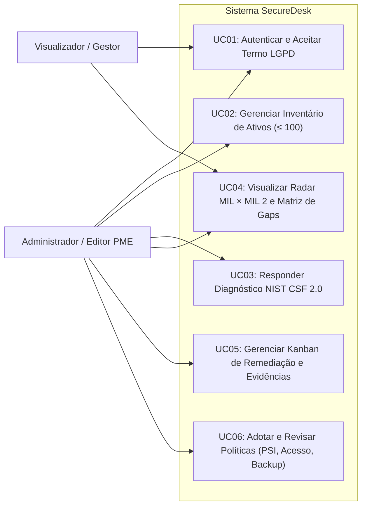

# Documento de Especificação de Requisitos de Software (ERS) — SecureDesk

> [!NOTE]
> **Projeto:** SecureDesk — Plataforma de Diagnóstico e Governança Progressiva de Cibersegurança para Pequenos Parques Tecnológicos (NIST CSF 2.0 × C2M2)
> **Curso:** Tecnologia em Análise e Desenvolvimento de Sistemas — FATEC Zona Leste (2026–2027)
> **Autores:** Bruno Cavalcante, Gabriel Andrew, Lucas Oliveira, Rafael Melo
> **Artefato TG1:** OEM 7a / Item 1.1 do `PLANO_DESENVOLVIMENTO.md`

---

## 1. Introdução e Escopo do Sistema

O **SecureDesk** é uma aplicação web projetada para Pequenas e Médias Empresas (PMEs) brasileiras que operam **pequenos parques tecnológicos (até 100 dispositivos gerenciados)**. O sistema operacionaliza um **Framework Híbrido de Cibersegurança** que combina:
- **Eixo Estrutural (Temático):** As 6 funções do **NIST Cybersecurity Framework (CSF) 2.0**:
  1. **GV — Govern (Governar)**
  2. **ID — Identify (Identificar)**
  3. **PR — Protect (Proteger)**
  4. **DE — Detect (Detectar)**
  5. **RS — Respond (Responder)**
  6. **RC — Recover (Recuperar)**
- **Eixo de Progressão (Maturidade):** Os Níveis Indicadores de Maturidade do **C2M2 (Cybersecurity Capability Maturity Model)** de **MIL 0 a MIL 3**, estabelecendo o **MIL 2** como patamar mínimo recomendado de conformidade e boas práticas (alinhado aos controles essenciais da ABNT NBR ISO/IEC 27001 e 27002).

### 1.1 Organização Modular e Fases do TCC
| Módulo | Nome | Escopo Resumido | Fase Alvo |
|---|---|---|---|
| **Core & Ativos** | Gestão da PME, Usuários, LGPD e Inventário | Cadastro da empresa, perfis de acesso, termo LGPD e inventário de ativos (limite de 100 dispositivos). | Especificação no TCC 1 / Implementação no TCC 2 |
| **Módulo 1** | Diagnóstico (Assessment) | Questionário estruturado pelas 6 funções do NIST CSF 2.0 com opções niveladas por MIL (0 a 3) e cálculo de maturidade. | OED 1, OED 3, OED 4 (TCC 1) / OED 5 (TCC 2) |
| **Módulo 2** | Acompanhamento e Priorização | Dashboard executivo, gráfico Radar (MIL atual × MIL 2 alvo), Score Global e Matriz de Prioridade (Impacto × Custo de Mitigação). | OED 4 (TCC 1) / OED 6 (TCC 2) |
| **Módulo 3** ⚠️ | Governança Operacional *(condicionado à Decisão 3.1)* | Geração automática de Gaps (práticas abaixo do MIL 2), quadro Kanban de tarefas de remediação e anexo de evidências. | OED 4 (TCC 1) / OED 7 (TCC 2) |
| **Módulo 4** ⚠️ | Compliance e Políticas *(condicionado à Decisão 3.1)* | Repositório de templates editáveis (PSI, Controle de Acesso, Backup), versionamento de revisões e alertas de vencimento. | OED 2 (TCC 1) / OED 8 (TCC 2) |

---

## 2. Atores e Perfis de Acesso (`PerfilUsuario`)

| Ator / Perfil | Código no Sistema | Permissões Principais |
|---|---|---|
| **Administrador da PME** | `ADMINISTRADOR` | Gerencia dados da empresa, cadastra/edita usuários, gerencia inventário de ativos, executa diagnósticos, aprova políticas e gerencia o Kanban de remediação. |
| **Editor / Analista de TI** | `EDITOR` | Mantém o inventário de ativos (até 100), responde ao diagnóstico de maturidade, movimenta tarefas no Kanban, anexa evidências e edita minutas de políticas. |
| **Visualizador / Gestor / Auditor** | `VISUALIZADOR` | Acesso somente leitura aos dashboards, gráfico radar, relatórios de diagnóstico, matriz de gaps e políticas publicadas. |

---

## 3. Requisitos Funcionais (RF)

### 3.1 Módulo Core: Autenticação, Empresa, Usuários e LGPD (`br.edu.securedesk.entity.core`)

| ID | Requisito Funcional | Prioridade | Entidades Relacionadas | Fase |
|---|---|---|---|---|
| **RF01** | **Cadastro e Configuração da Empresa (PME):** O sistema deve permitir o cadastro e atualização dos dados da empresa (razão social, nome fantasia, CNPJ único, setor de atuação, porte, e-mail de contato e telefone). | Essencial | `Empresa`, `PorteEmpresa`, `SetorEmpresa` | Núcleo |
| **RF02** | **Gestão de Usuários e Perfis:** O sistema deve permitir ao `ADMINISTRADOR` cadastrar, listar, editar e ativar/inativar usuários vinculados à sua empresa, atribuindo-lhes um perfil (`ADMINISTRADOR`, `EDITOR` ou `VISUALIZADOR`). | Essencial | `Usuario`, `PerfilUsuario` | Núcleo |
| **RF03** | **Autenticação de Usuários:** O sistema deve autenticar usuários mediante e-mail e senha criptografada, bloqueando o acesso de contas com `ativo = false`. | Essencial | `Usuario` | Núcleo |
| **RF04** | **Registro de Consentimento LGPD:** No primeiro acesso (ou quando houver nova versão do termo), o sistema deve exigir e registrar o aceite do Termo de Consentimento LGPD contendo versão do termo, data/hora do aceite e endereço IP de origem. | Essencial | `TermoConsentimentoLgpd` | OEM 6a / Núcleo |

### 3.2 Inventário de Parque Tecnológico (`br.edu.securedesk.entity.ativo`)

| ID | Requisito Funcional | Prioridade | Entidades Relacionadas | Fase |
|---|---|---|---|---|
| **RF05** | **CRUD de Ativos de TI:** O sistema deve permitir cadastrar, consultar, atualizar e remover ativos tecnológicos da PME (nome, categoria/tipo, descrição, quantidade, localização, responsável e status ativo). | Essencial | `AtivoTI`, `TipoAtivo` | Núcleo |
| **RF06** | **Validação do Limite de Pequeno Parque (Trava de 100 Ativos):** O sistema deve validar a soma da quantidade de ativos ativos da empresa e impedir qualquer inclusão ou edição que ultrapasse o limite de **100 dispositivos gerenciados** (`RN01`). | Essencial | `AtivoTI`, `Empresa` | Núcleo |
| **RF07** | **Classificação por Categoria de Ativo:** Todo ativo deve ser classificado obrigatoriamente nas categorias do parque tecnológico definidas pelo framework (`ENDPOINTS`, `SERVIDORES_LOCAIS`, `ATIVOS_REDE`, `MOBILE_E_NUVEM` — *ver Decisão 3.3*). | Essencial | `TipoAtivo` | Núcleo |

### 3.3 Módulo 1: Diagnóstico de Maturidade (`br.edu.securedesk.entity.diagnostico`)

| ID | Requisito Funcional | Prioridade | Entidades Relacionadas | Fase |
|---|---|---|---|---|
| **RF08** | **Catálogo de Funções e Questões NIST × C2M2:** O sistema deve manter o banco de questões estruturado pelas 6 funções do NIST CSF 2.0 (`GV`, `ID`, `PR`, `DE`, `RS`, `RC`), contendo referência normativa (NIST/ISO 27001/27002), ordem de exibição e opções de resposta associadas aos níveis `MIL_0`, `MIL_1`, `MIL_2` e `MIL_3`. | Essencial | `FuncaoNist`, `SiglaFuncaoNist`, `QuestaoDiagnostico`, `OpcaoResposta`, `NivelMil` | OED 3 / OED 5 |
| **RF09** | **Abertura e Execução de Diagnóstico:** O sistema deve permitir iniciar um novo ciclo de diagnóstico (`EM_ANDAMENTO`), salvar respostas parciais por função do NIST e registrar observações por questão. | Essencial | `Diagnostico`, `StatusDiagnostico`, `RespostaDiagnostico` | OED 5 |
| **RF10** | **Finalização e Cálculo de Maturidade (Motor de Score):** Ao concluir o questionário (todas as questões obrigatórias respondidas), o sistema deve calcular o nível MIL alcançado (`MIL 0` a `MIL 3`) e o percentual de progresso (`0%` a `100%`) em cada uma das 6 funções do NIST, além do score global do diagnóstico (`RN02`). | Essencial | `Diagnostico`, `ScoreFuncao`, `NivelMil` | OED 1 / OED 5 |
| **RF11** | **Histórico e Comparação de Diagnósticos:** O sistema deve preservar os diagnósticos concluídos (`CONCLUIDO`), permitindo comparar a evolução de maturidade da empresa ao longo do tempo (linha de base inicial vs. reavaliações). | Importante | `Diagnostico`, `ScoreFuncao` | OED 5 / OEM 8 |

### 3.4 Módulo 2: Acompanhamento, Radar e Matriz de Prioridade (`diagnostico` + `governanca`)

| ID | Requisito Funcional | Prioridade | Entidades Relacionadas | Fase |
|---|---|---|---|---|
| **RF12** | **Dashboard Executivo e Radar NIST × MIL:** O sistema deve apresentar um gráfico Radar comparando o nível MIL atual da empresa em cada função (`GV`, `ID`, `PR`, `DE`, `RS`, `RC`) contra a linha de referência do patamar mínimo recomendado (**MIL 2**). | Essencial | `ScoreFuncao`, `Diagnostico` | OED 4 / OED 6 |
| **RF13** | **Identificação Automática de Gaps:** Para toda questão cujo nível respondido no diagnóstico seja inferior ao patamar recomendado (`MIL 2`), o sistema deve registrar um `Gap` indicando o nível atual, o nível alvo (`MIL_2`), o impacto e o custo estimado de mitigação. | Essencial | `Gap`, `NivelImpacto`, `CustoMitigacao`, `Prioridade` | OED 6 |
| **RF14** | **Matriz de Priorização (Impacto × Custo de Mitigação):** O sistema deve classificar e exibir os gaps identificados cruzando `NivelImpacto` (`BAIXO`, `MEDIO`, `ALTO`, `CRITICO`) e `CustoMitigacao` (`BAIXO`, `MEDIO`, `ALTO`), destacando os "Quick Wins" (alto impacto de segurança e baixo custo para a PME). | Essencial | `Gap`, `Prioridade` | OED 6 |

### 3.5 Módulo 3: Governança Operacional — Kanban e Evidências (`br.edu.securedesk.entity.governanca`)

> [!IMPORTANT]
> Os requisitos do Módulo 3 implementam o OED 7 e estão sujeitos à confirmação de escopo na **Decisão 3.1**.

| ID | Requisito Funcional | Prioridade | Entidades Relacionadas | Fase |
|---|---|---|---|---|
| **RF15** | **Quadro Kanban de Remediação:** O sistema deve permitir gerenciar tarefas de remediação organizadas em colunas de status (`BACKLOG`, `EM_ANDAMENTO`, `CONCLUIDO`), vinculadas aos gaps do diagnóstico e às funções do NIST. | Desejável / TCC 2 | `TarefaRemediacao`, `StatusTarefa`, `Prioridade` | OED 4 / OED 7 |
| **RF16** | **Upload e Registro de Evidências:** O sistema deve permitir anexar arquivos de evidência comprobatória (ex: prints de configuração de firewall/MFA, atas, relatórios de backup) às tarefas de remediação, registrando nome do arquivo, tamanho, autor e timestamp. | Desejável / TCC 2 | `Evidencia`, `TarefaRemediacao` | OED 7 |

### 3.6 Módulo 4: Compliance, Templates de Políticas e Alertas (`br.edu.securedesk.entity.compliance`)

> [!IMPORTANT]
> Os templates base (OED 2) são entregáveis do TCC 1; o módulo dinâmico (OED 8) pertence ao TCC 2 conforme **Decisão 3.1**.

| ID | Requisito Funcional | Prioridade | Entidades Relacionadas | Fase |
|---|---|---|---|---|
| **RF17** | **Catálogo de Templates de Políticas (PSI, Acesso, Backup):** O sistema deve disponibilizar templates normativos pré-estruturados (Política de Segurança da Informação, Controle de Acesso e Backup) mapeados para a ISO 27001/27002, LGPD e funções do NIST. | Essencial (OED 2) | `TemplatePolitica`, `FuncaoNist` | OED 2 / OED 8 |
| **RF18** | **Adoção, Customização e Versionamento de Políticas pela PME:** A empresa deve poder instanciar uma política a partir de um template, editar seu conteúdo, controlar seu status (`EM_ELABORACAO`, `PENDENTE_REVISAO`, `EM_DIA`, `VENCIDA`), definir data de vigência/vencimento e registrar o histórico de revisões. | Desejável / TCC 2 | `PoliticaEmpresa`, `StatusPolitica`, `HistoricoRevisaoPolitica` | OED 8 |
| **RF19** | **Notificações de Governança e Conformidade:** O sistema deve emitir notificações internas para alertar sobre revisão periódica de políticas, tarefas de remediação atrasadas e ciclos de reavaliação de diagnóstico. | Desejável / TCC 2 | `Notificacao`, `TipoNotificacao` | OED 8 |

---

## 4. Regras de Negócio (RN)

| Código | Regra de Negócio | Impacto Técnico |
|---|---|---|
| **RN01** | **Limite Estrito de Pequeno Parque (≤ 100 Dispositivos):** A soma dos campos `quantidade` de todos os registros de `AtivoTI` com `ativo = true` pertencentes a uma mesma `Empresa` não pode exceder **100 unidades**. Caso um cadastro ou atualização ultrapasse 100, a operação deve ser rejeitada com mensagem explicativa sobre o recorte metodológico do framework. | Validação no Service (`AtivoService`) + constraint visual no formulário. |
| **RN02** | **Progressão Cumulativa de Maturidade C2M2 (*ver Decisão 3.4*):** Segundo o C2M2, os níveis MIL são cumulativos: uma função do NIST (`GV`, `ID`, `PR`, `DE`, `RS`, `RC`) só atinge formalmente o nível `MIL_k` ($k \in \{1,2,3\}$) se todas as práticas avaliadas até o nível $k$ naquela função estiverem integralmente atendidas. Paralelamente, o sistema calcula o `percentualProgresso` ($0\%$ a $100\%$) para refletir avanços parciais no Dashboard antes do fechamento completo do degrau. | Especificado em `docs/ESPECIFICACAO_SCORE_C2M2.md` e implementado em `ScoreService`. |
| **RN03** | **Patamar Mínimo Recomendado (MIL 2):** O nível **MIL 2** (práticas documentadas, atribuídas e verificadas, aproximando a PME da ABNT NBR ISO/IEC 27001/27002) é parametrizado como linha de corte. Qualquer questão respondida com nível inferior a `MIL_2` gera automaticamente um `Gap` (`resolvido = false`). | `ScoreService` / `GapService` e linha de meta no gráfico Radar (Chart.js). |
| **RN04** | **Isolamento Multi-Empresa (Tenant Isolation):** Um usuário autenticado só pode visualizar, cadastrar ou alterar ativos, diagnósticos, gaps, tarefas, evidências e políticas pertencentes à sua própria `Empresa` (`usuario.empresa.id`). | Filtro obrigatório por `empresaId` nas consultas de Repository/Service. |
| **RN05** | **Aceite Obrigatório da LGPD:** Nenhum usuário pode acessar os módulos operacionais sem possuir um registro válido de `TermoConsentimentoLgpd` com `aceito = true` para a versão vigente do termo. | Interceptor / filtro de segurança pós-login. |
| **RN06** | **Imutabilidade de Diagnóstico Concluído:** Uma vez que o `Diagnostico` muda de `EM_ANDAMENTO` para `CONCLUIDO`, suas respostas (`RespostaDiagnostico`) e scores (`ScoreFuncao`) tornam-se somente leitura para preservar a rastreabilidade histórica do estudo de caso. | Verificação de status em `DiagnosticoService`. |

---

## 5. Requisitos Não-Funcionais (RNF)

| ID | Categoria | Descrição e Critério de Aceite |
|---|---|---|
| **RNF01** | **Segurança (Autenticação e Senhas)** | As senhas de `Usuario` jamais devem ser armazenadas em texto claro; deve-se utilizar hash adaptativo **BCrypt** (via Spring Security) e proteção contra CSRF nos formulários web. |
| **RNF02** | **Privacidade e Conformidade LGPD (OEM 6a)** | Coleta mínima de dados pessoais (apenas nome, e-mail corporativo e IP de aceite do termo), registro auditável em `tb_termo_consentimento_lgpd` e separação lógica por empresa. |
| **RNF03** | **Usabilidade para PMEs** | Linguagem acessível ao gestor/técnico de PME (evitando jargão excessivo sem explicação contextual), navegação em até 3 cliques entre Dashboard, Diagnóstico e Plano de Ação, e interface responsiva renderizada via **Thymeleaf**. |
| **RNF04** | **Portabilidade de Banco de Dados** | Suporte transparente a **H2 Database em memória** no perfil `dev` (para execução imediata sem infraestrutura externa via `./mvnw spring-boot:run`) e **MySQL / MariaDB** no perfil `prod`. |
| **RNF05** | **Desempenho** | O cálculo completo do diagnóstico (6 funções NIST + geração de scores e gaps) deve executar em menos de **1 segundo** para um questionário de até 60 questões. |
| **RNF06** | **Manutenibilidade e Testabilidade** | Arquitetura em camadas (`controller`, `service`, `repository`, `entity`, `dto`) sob Java 21 + Spring Boot, com cobertura de testes unitários (JUnit 5) em 100% das regras matemáticas do `ScoreService`. |

---

## 6. Casos de Uso Principais (UC)

### Resumo do Fluxo Principal (UC02 → UC03 → UC04):
1. **Onboarding e Inventário (`UC01` + `UC02`):** O Administrador faz login, registra o aceite LGPD, configura os dados da PME e cadastra o parque tecnológico (ex: 30 estações de trabalho, 2 servidores locais, 4 ativos de rede e 10 contas móveis/nuvem = 46/100 ativos).
2. **Diagnóstico (`UC03`):** O usuário percorre as 6 abas correspondentes às funções do NIST CSF 2.0 (`Govern`, `Identify`, `Protect`, `Detect`, `Respond`, `Recover`), selecionando para cada questão a opção que reflete a prática atual da empresa (`MIL 0` a `MIL 3`).
3. **Cálculo e Acompanhamento (`UC04`):** Ao finalizar, o motor de score aplica a regra cumulativa do C2M2, grava os `ScoreFuncao`, gera os `Gap` para tudo que estiver abaixo do `MIL 2` e exibe o gráfico Radar comparativo junto à Matriz de Prioridade (Impacto × Custo).
4. **Governança e Políticas (`UC05` + `UC06`):** Os gaps geram tarefas acionáveis no Kanban (com upload de evidências) e a PME adota os templates de PSI, Controle de Acesso e Backup para atingir a conformidade documental exigida pelo **MIL 2**.

---

## 7. Matriz de Rastreabilidade (Objetivos do TCC × Requisitos)

| Código TCC (`tcc-projeto.html`) | Descrição do Entregável | Requisitos Relacionados | Artefato de Engenharia |
|---|---|---|---|
| **OEM 2** | Delimitação do pequeno parque (< 100 ativos) | RF05, RF06, RF07, RN01 | `docs/REQUISITOS.md`, `AtivoTI` |
| **OEM 5 / OED 1** | Matriz NIST × MIL, regra cumulativa e validação em planilha | RF10, RN02, RN03 | `docs/ESPECIFICACAO_SCORE_C2M2.md` |
| **OEM 6a** | Mapeamento de requisitos da LGPD no sistema | RF04, RN04, RN05, RNF01, RNF02 | `docs/REQUISITOS.md`, `TermoConsentimentoLgpd` |
| **OEM 7a** | Especificação RF/RNF, DER, protótipo navegável e plano de testes | Todos (RF01–RF19, RNF01–RNF06) | `docs/REQUISITOS.md`, `docs/DER.md`, Protótipo Thymeleaf |
| **OED 2** | Templates base de PSI, Controle de Acesso e Backup | RF17, RF18 | `TemplatePolitica` |
| **OED 3** | Questionário de diagnóstico categorizado por função NIST e MIL | RF08, RF09 | `QuestaoDiagnostico`, `OpcaoResposta` |
| **OED 4** | Protótipo navegável (Diagnóstico, Radar e Kanban) | RF09, RF12, RF14, RF15 | `PageController` + Templates Thymeleaf |
